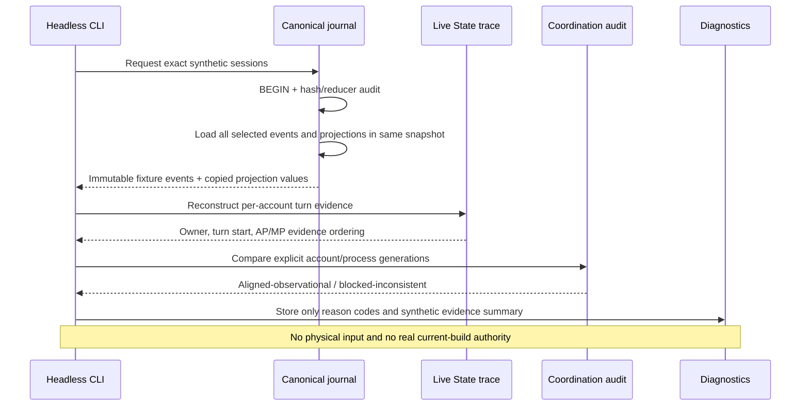

# P11 — Transaction-safe fight/turn evidence and CRA/ENU observation audit

**Release scope: synthetic, read-only, offline. This system does not decode the current Dofus client, certify a live fight, authorize a turn, or send physical input.**

## Why this slice exists

The historical ANKA project repeatedly experienced Ready-to-first-turn stalls, unexpected CRA→ENU handoff blocks and misleading AP/MP freshness failures. Recreating those issues safely requires preserving **evidence for both accounts at once** rather than auditing one character and assuming the peer saw the same game state.

Before P11, the P8 journal was replayable per session and P9 could audit one session in a stable read snapshot. The missing seam was a *bounded, consistent, multi-session investigation* across Canonical journal, Live State turn history, and Coordination, while keeping those three packages separate.

A SQLite read snapshot is a guarantee about **local database consistency**, not about network-event simultaneity. Two observers agreeing on turn owner do not prove they observed the same authoritative event; the P11 report deliberately lacks any activation token.

## New file ownership and permitted dependencies

| Package and file | Owns | Permitted dependencies |
|---|---|---|
| `anka_contracts/fight_audit.py` | Immutable scope and read-only report DTOs | Python stdlib |
| `anka_canonical/journal.py` (new `audited_evidence`) | One SQLite read transaction, hash replay and bounded multi-session histories | `anka_contracts.state`, reducer port |
| `anka_live_state/fight_trace.py` | Pure history-to-turn evidence, AP/MP evidence ordering | `anka_contracts.state` |
| `anka_coordination/fight_audit.py` | Cross-observer consistency diagnostics only | `anka_contracts.fight_audit` |
| `anka_app/fight_offline.py` | Compose independent systems, synthetic demo, diagnostic receipt | public APIs above |
| `tests/test_p11_fight_evidence.py` | Historical-style positive and negative oracles | independent test harness |

No source from `anka_capture`, `anka_protocol`, `anka_game_kernel`, `anka_decision` or `anka_execution` is imported by the Coordination comparison engine. The existing P8 projection schema is unchanged, so P11 avoids invalidating old synthetic journal hashes.

## Data flow



## Guarantees independently tested

1. Every requested session is re-audited from the *same SQLite read snapshot*. Conflicting, reordered or tampered event histories are not accepted.
2. Session count (1–16) and complete history count (default 4,096 per session) are bounded; excess history **fails explicitly**, never silently truncates.
3. The comparison layer requires explicit session, account, process generation and local actor identities; duplicated or ambiguous account requests are refused.
4. Local fight IDs and observed turn owners must match to count as observational alignment. Any disagreement is a named diagnostic failure.
5. The turn trace distinguishes AP/MP values observed **before TURN_STARTED within the same fight** from values observed afterward. Neither ordering alone proves live freshness; it avoids the old mistake of automatically rejecting early observations.
6. A new fight resets the derived turn evidence; earlier-fight values cannot leak into its resource timeline.
7. A trace that does not match the audited snapshot revision is rejected instead of being paired with a newer projection.
8. A caller that fails to supply evidence of one coherent DB read snapshot cannot claim multi-session alignment.
9. Historical semantic drafts remain in quarantine; only synthetic `OfflineStateEvent` can enter the test journal.
10. An inconsistent synthetic handoff produces a GPT-friendly, checksum-verifiable incident when diagnostic storage is available. Its failure does not change the audit result.
11. Malformed/untyped actor maps produce explicit diagnostic reasons, not uncaught exceptions. The report lists missing HP/AP/MP/cell/cooldown facts even if owners align; alignment is not state completeness.
12. A successfully executed but inconsistent CLI audit returns exit code `10`, not success code `0`; `fight-demo` intentionally demonstrates conflict and exits `0` as a demonstration.

## Commands

```bat
fight_demo.bat
fight_audit.bat "C:\path\synthetic.sqlite3" "cra-session:cra:1:777" "enu-session:enu:1:888"
verify.bat
```

`fight-demo` creates two synthetic sessions, demonstrates observations initially aligned with CRA owning the turn, and then intentionally advances only ENU's observer to ENU's turn to simulate a handoff disagreement. Expected output:

- `aligned.status=ALIGNED_SIMULATED_ONLY`, **not** live-ready.
- `divergent_handoff.status=BLOCKED_INCONSISTENT`, with `TURN_OWNER_CONFLICT`.
- Both contain `CURRENT_BUILD_PROTOCOL_NOT_CERTIFIED` and `NO_SHARED_CURRENT_BUILD_EVENT_PROOF`.
- `live_ready=false`, `physical_input_sent=false`, `shared_live_event_proof=false`, `actionable=false`.

The `fight-audit` command accepts **P8-style synthetic databases only**; it checks the existing file read-only. Arguments specify expected session, account, process generation, and local actor. It does not derive the true account identity from a window title. Exit code `0` means the synthetic comparison ran with no observed turn/fight disagreement, **not** that gameplay is ready. Exit code `10` means evidence inconsistency was detected; exit code `40` means the command itself failed. All authoritative/live flags remain false.

## Negative cases and limitations

| Case | Expected failure/limitation |
|---|---|
| Other account has started the next turn | `TURN_OWNER_CONFLICT` |
| Accounts report different fights | `FIGHT_ID_CONFLICT` |
| Missing/ended turn | `TURN_OWNER_UNPROVEN` or `NO_ACTIVE_FIGHT` |
| Wrong process generation / class-context handoff | `ACCOUNT_IDENTITY_OR_GENERATION_MISMATCH` |
| Session missing or actor unknown | `MISSING_SESSION_SNAPSHOT` / `LOCAL_ACTOR_NOT_OBSERVED` |
| Corrupt or partial journal | Raise explicit journal integrity/limit error |
| Stale trace paired with new projection | `TURN_TRACE_SNAPSHOT_MISMATCH` |
| Independent snapshots supplied directly | `MULTI_SESSION_SNAPSHOT_NOT_ATTESTED` |
| Two matching simulated snapshots | `ALIGNED_SIMULATED_ONLY`, *never* 'READY' |
| Diagnostics disk failure | Unavailable bundle noted; audit meaning preserved |
| Malformed actor dictionary, missing local actor fields | Explicit actor-shape reason codes and per-account `missing_decision_fields` |
| Tool successfully detects owner contradiction | `ANKA_STATUS=BLOCKED_INCONSISTENT`, nonzero exit `10`, incident ZIP |

**Still unresolved:** proof of *shared real game-event causality*, time-bounded network freshness, protocol version certification, independent CRA/ENU process/character identity, ready-state decoding, game fight epochs with validated server IDs, spell casts, Windows capture, true mouse projection, FightAI, coordination workflow and physical execution.

A future controlled runtime must introduce a shared server/event correlation proof and compatible timestamp/epoch semantics; **do not change `same_database_snapshot` into an action eligibility flag**.

## Regression and release policy

Run the entire inherited suite and P11 tests. Capture exact fresh-ZIP verification results in the receipt. Reuse R5.198 incident history as hypotheses/tests, not as proof that this new project already fixed the live faults. `start.bat` must continue returning `LIVE_RUNTIME_NOT_IMPLEMENTED` with a diagnostic bundle. No new network source or automatic input backend is included in P11.
