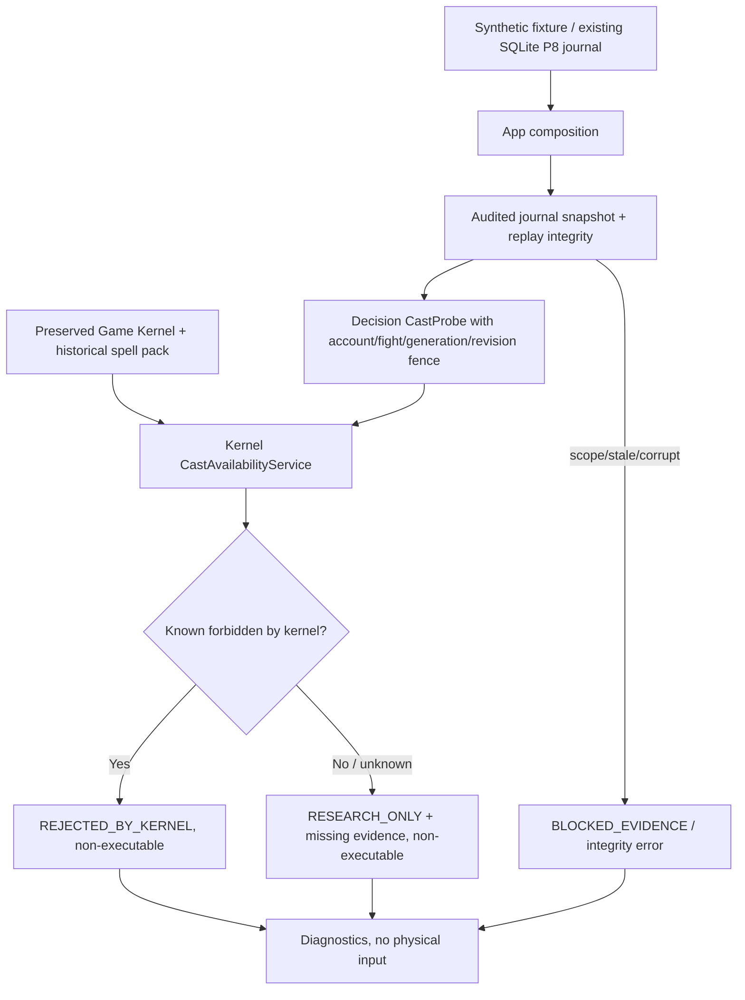

# P12 — Independent read-only Decision feasibility, real Kernel + synthetic P8/P11 evidence

**Scope:** offline-only Decision System entry slice, 20 October 2026. No input authority. No implementation of turn planner, target scoring, movement, spell choice, CRA/ENU tactical policy or combat automation. Live control is disabled.

## Why this milestone

Historical ANKA failures included wrong plans crossing decision/execution boundaries, casts without sufficient AP/cooldown/cast-count information, missing map geometry, stale turn owner, and repeated rejected actions. A decision module must distinguish **known illegal**, **not enough evidence**, and **fully executable**. P12 implements only the first two outcomes. It cannot output the third.

P11's Synthetic State records HP, AP, MP, position, cooldowns and turn owner. It does **not** prove current Dofus build semantics; equipped spell slots; current map walkability, geometry or line of sight; actor's class or cast counters. Treating P11 alone as complete spell-planning input would recreate earlier bugs. This is a **deliberate capability limit**, not a missing fallback.

## Files and dependency boundaries

- `src/anka_contracts/decision.py`: immutable `CastProbe`, `CastProbeReport`, validated session/account/process-generation/fight/revision/actor/spell/grade/target identity. Reports have no executable action interface.
- `src/anka_decision/probe.py`: pure feasibility probe. Imports contracts and preserved Game Kernel only; no Protocol, Capture, Client, Workflow, Coordination, Live State implementation or input driver.
- `src/anka_app/decision_offline.py`: sole composition root connecting pure synthetic P8 reducer, audited P8 SQLite journal, real R5.198 kernel, and Decision probes.
- `tests/test_p12_decision_probe.py`: previous regressions plus negative and integration tests.
- `decision_demo.bat` and `decision_audit.bat`: observation-only Windows wrappers using common diagnostic bootstrap.

## Flow



P12 demonstrates against original historical **Flèche Glacée** static grade 3. AP=0 is statically insufficient; a positive cooldown is illegal; AP=11 plus a zero cooldown is *not* proof of a permissible cast because cast counters, map, LoS and equip metadata are absent. The real Kernel's cast-availability evaluator is called directly. The demo does not simulate a game client or authorize a cast.

## Contracts and failure semantics

`CastProbe` requires exact tokenized session/account/fight, generation, actor, spell id, grade, cell and minimum revision. Snapshot mismatches (including boolean identity impersonation), ended fight, owner mismatch, missing/inconsistent revision, missing actor data, impossible numeric values, untrusted authority flag, malformed or duplicated cooldowns: `BLOCKED_EVIDENCE`. Unknown spell/grade or unresolved rules: `BLOCKED_STATIC_DATA`. Kernel cast-availability explicit negative: `REJECTED_BY_KERNEL`. Incomplete or seemingly available constraints: `RESEARCH_ONLY` with `missing_kernel_inputs` and separately named architectural evidence gaps. Kernel errors remain blocked. **No positive readiness status exists** in this contract; it cannot be passed to Execution.

A read-only `decision-audit` uses `SQLiteFixtureJournal.audited_snapshot` so replay integrity and projection state are read within one SQLite snapshot. A corrupt or absent journal fails closed. Observed conflicts produce a nonzero exit code 10, except a valid negative kernel evaluation is treated as a completed diagnostic (exit 0). The user should review `ANKA_RESULT` and incident ZIP.

## Commands

```bat
setup.bat
verify.bat
decision_demo.bat
decision_audit.bat "C:\path\synthetic.sqlite3" cra-session cra 1 test-fight 8 777 32435 3 220
```

Note: `decision-audit` requires a **synthetic P8 journal**. It cannot read arbitrary live SQLite histories, decode real packets or infer authoritative state. No network, mouse, keyboard or game input is used.

## Remaining gates

1. Exact-current-build certified semantic events, authoritative Canonical admission with source provenance and transport completeness; no synthetic fixture promotion.
2. Complete read-only Kernel-consumer view with map identity, current walkability and LoS, actor identity, equipment, spell grade, cooldown/cast counters, range modifiers and lifecycle epochs.
3. Multi-account immutable snapshot pinning plus decision expiration/revalidation; replay test for CRA/ENU turn handoff and player-window generation swaps.
4. Candidate enumeration, map-aware legality via `GameKernel.spell_decisions.evaluate_cast_cell`, tactical scoring and deterministic projected outcome verification.
5. Execution accepts *only* a separately issued short-lived permit after its own independently verified state/context checks; never accepts a `CastProbeReport` as input.
6. Windows host test, protocol certification and complete live acceptance remain outstanding. `start.bat` still refuses control.

## Verification criteria

- All inherited P11 tests continue to pass.
- New P12 unit, adversarial and journal/CLI tests pass.
- Test an actual preserved kernel with AP/cooldown rejection and incomplete-cast reason.
- No Decision→Capture/Protocol/Execution/Client/Live State implementation imports.
- Read-only audited journals remain unchanged; corrupt histories cannot yield a decision report.
- All paths set `physical_input_permitted=false`, `actionable=false`, `authoritative=false`; `start` fails closed.

**Do not interpret an offline static rejection as evidence that the live spell mechanics of a future game update are unchanged.**
