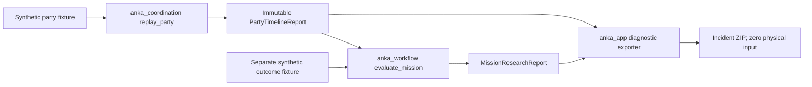

# P17 — Deterministic Party Coordination and Mission Workflow (research-only)

## Architecture and responsibilities

The new `anka_coordination/party_lifecycle.py` owns *party participation*, Readiness, fight epoch, current turn owner, pending End-Turn intent, observed Turn End, next-owner waiting, and failure quarantine. It knows nothing about mission victory counts or decisions.

The new `anka_workflow/mission_research.py` owns *mission progress* derived from immutable Coordination reports and separate, explicitly synthetic fight outcome records. It knows nothing about network packets, physical input, spell casts, or the concrete Coordination implementation.

`anka_app/coordination_offline.py` is the only composition layer importing both systems. Contracts are under `anka_contracts/{coordination_flow,workflow_flow}.py`. They cannot represent actionable/live-certified results.



## Lifecycle rules

`WAIT_READY -> WAIT_FIGHT -> WAIT_FIRST_TURN -> TURN_ACTIVE -> WAIT_TURN_END -> WAIT_NEXT_TURN -> TURN_ACTIVE -> ... -> FINISHED`.

- All configured party members must provide scoped Ready evidence before fight-start; readiness is not proof of an active turn.
- Fight ID is immutable within a synthetic epoch. Account generation and actor ID must match the expected member on every account-scoped event.
- `END_TURN_INTENDED` means a *hypothetical request*, **not** physical input and **not** confirmed turn completion.
- The next owner cannot start until a matching `TURN_ENDED` event is observed. `FIGHT_ENDED` may end a fight during an active turn (outcome unknown).
- A monotonic integer fixture tick permits deterministic timeout tests; the timeout is checked **on every event**, including late confirmations, and not only on explicit `CHECK`.
- On the first conflict the report becomes `QUARANTINED`, captures the exact first failure and stops consuming later events. Reconnection/recovery require a new independently verified epoch in a future live system.
- A successful synthetic fight does not count as victory. Workflow requires a separate outcome record, refuses duplicate/orphan outcomes, and checks the loss budget.
- All results are read-only, `synthetic_only=true`, `actionable=false`, `authoritative=false`, `physical_input_permitted=false`.

## Run and diagnose

`coordination_demo.bat` (default: synthetic happy handoff). Other bounded scenarios:

```
coordination_demo.bat handoff
coordination_demo.bat missing-end-confirmation
coordination_demo.bat overlapping-owner
coordination_demo.bat missing-next-owner
coordination_demo.bat fight-without-win
```

Exit code 0 means the research audit ran with no **coordination conflict**, not that live controls are ready. Exit code 10 means the audit quarantined an inconsistent timeline and emitted a GPT-friendly incident ZIP. A fight may complete without a known victory: the *mission* then reports `BLOCKED_SYNTHETIC` even while the coordination audit returns 0. Exit code 40 indicates a bootstrap/command failure.

## Historical incidents represented

- Both Ready but no fight/turn observation, including `P17_FIRST_TURN_TIMEOUT`.
- End Turn requested but not proven, including `P17_TURN_END_UNCONFIRMED`.
- CRA and ENU simultaneous/overlapping turn-owner observations.
- Wrong actor/account generation, stale fight epoch, duplicate ready evidence.
- Handoff confirmation delayed past deadline even without a standalone watchdog event.
- Game process/account disconnect and terminal-state continuation.
- Fight ended but no independently observed victory/outcome.

## Proof / limitations

P17 is deliberately **not a live controller**. Event fixtures are authored offline; they are not current-client protocol facts. The implementation does not own the live network/Unity bridge, process control, physical input, authoritative journal admission, actual turn timeouts, game disconnect recovery, or mission routing. All must be developed and certified separately. This milestone cannot prove that CRA/ENU turns in the current game are actually correlated or that a click was sent or acknowledged.

## Permanent gates

- Existing P16 regression tests remain green.
- All P17 contract/transition/negative/CLI/incident tests pass, including adversarial cases.
- Source package imports cross only via contracts and composition, never into Execution internals.
- Fresh ZIP extraction runs tests and demonstrates normal and quarantined scenarios.
- `start` remains explicitly blocked with `LIVE_RUNTIME_NOT_IMPLEMENTED`.
