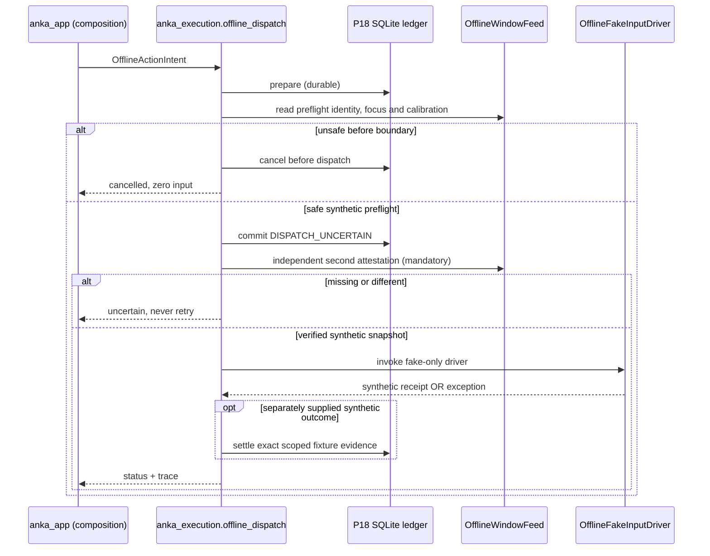

# P19 — Offline Fake-Driver Execution Integration and Fault Injection

**Scope:** Complete updated ANKA_NEXT with an **offline-only fake driver** connecting P18's durable action ledger to deterministic simulated window checks and synthetic outcome fixtures. **No OS input driver, current-build protocol certification, or live game authority is implemented.**

## Architecture



- `src/anka_contracts/execution_simulation.py` declares strict immutable, **non-authoritative** window observations, fake-driver receipts and dispatch reports.
- `src/anka_execution/fake_input.py` provides deterministic fake-only driver responses and sequential *read-only simulated* window observations. Neither module imports GUI or OS input libraries.
- `src/anka_execution/offline_dispatch.py` integrates the P18 SQLite action ledger with simulated preflight/re-attestation and explicit fake-only driver dispatch. It accepts only **exactly** the `OfflineFakeInputDriver` class, not arbitrary injected drivers, and it does not own or send real game input.
- `src/anka_app/execution_simulation.py` assembles test fixtures, journals, observer events and sanitized GPT-friendly incident reports. Cross-system composition remains in `anka_app`.
- `tests/test_p19_offline_fake_driver.py` covers contracts, sequencing, contention, fake IO, fake crashes, and diagnostic artifacts.

## Failure invariants and historical lessons

1. **Persist uncertainty before any possible IO:** a durable `DISPATCH_UNCERTAIN` transition occurs before calling the fake driver. If a crash follows that boundary, restart does not resend.
2. **A fake driver call is not game confirmation:** a receipt merely tells us which simulation branch ran. Without *separately supplied synthetic evidence*, the action stays uncertain. Real server confirmation requires a future independently certified causal matcher.
3. **Account and window are not inferred from names:** preflight requires exact account, client, window generation, verified character, focus and calibration *fixtures*. If a check fails before dispatch, cancel safely without attempting the driver. If any check fails after dispatch boundary, remain uncertain.
4. **Re-attestation must actually take place:** the window feed refuses to reuse a single stale snapshot when a second one is required. A missing observation leaves uncertainty rather than silently declaring focus valid.
5. **One global uncertain action:** P18's SQLite single-dispatch gate applies across CRA/ENU and even concurrent SQLite connections. A second account blocked before dispatch is cancelled; the older uncertain action remains preserved.
6. **No blind retry:** duplicate action IDs, logical action keys and unknown outcomes do not authorize repeated driver calls. This remains true across process restarts.
7. **Crash and DB consistency:** injections after PREPARED, after durable boundary, after fake attempt, and inside P18's transactional writes cover cases where a caller can no longer know whether a real driver would have emitted input.
8. **Telemetry should never grant authority:** typed reports and returned objects cannot claim `actionable`, `live_ready` or physical input. An incident ZIP records the first failing logical boundary, action identifiers, status and evidence gaps without exporting raw network traffic or the SQLite ledger.
9. **No full success from offline tests:** fixtures prove only the model's behavior. Current-build semantic decoding, live-window attestation, server-observed settlement and physical Windows input are still absent.

## Commands

```bat
setup.bat
execution_sim_demo.bat
execution_sim_demo.bat confirmed-fixture
execution_sim_demo.bat focus-lost
execution_sim_demo.bat generation-changed
execution_sim_demo.bat driver-raises-after
execution_sim_demo.bat crash-after-boundary
execution_sim_demo.bat second-account-contention
execution_sim_demo.bat restart-no-retry
execution_audit.bat "C:\path\to\p19_simulated_driver.sqlite3"
debug.bat --verify "C:\path\to\incident.zip"
verify.bat
start.bat   REM Must refuse with exit 40
```

- `execution-sim-demo` is a **successful demonstration** command; it returns exit 0 even if the scenario intentionally leaves dispatch `BLOCKED_UNCERTAIN`. The result contains the status and an incident path. `execution-audit` returns exit 10 for unresolved saved actions, as established in P18.
- All runs begin with the same early observer and include an invocation/run ID. Check `runtime/runs/...` for local diagnostic evidence. Review bundles before sharing them.
- The fake is incapable of Windows input by implementation. The simulator's `fake_attempt_count` and `driver_invocations` are **simulation metrics**, not proof of live actions.

## Missing gates

- Independent verified current-client Canonical evidence and character/class identity.
- Window-focus, PID/HWND, window-generation and calibration verification on Windows; fresh evidence at the actual input instant, not only two earlier observations.
- Physical input authority, tightly scoped exclusive lease and OS-specific timing/retry safety. **This must be a separate later milestone, not a switch in this offline simulator.**
- Real server-side outcome causal correlation. A missing action ID in Dofus messages cannot be invented; ambiguous outcomes must remain uncertain.
- Watchdog after stalls, controlled reconnection, multi-account recovery, power-loss durability, performance on the user's host and controlled live acceptance.
- Intermittent inherited verification-run latency and SQLite ResourceWarnings require a separate investigation. Increasing timeouts is not a root-cause correction.

**Next recommended milestone:** after P19, establish contract-checked, offline end-to-end integration spanning synthetic Canonical state → Decision → Coordination → Execution, using a single deterministic replay runner and injecting loss, delay, focus change, and out-of-order outcomes. Continue to forbid live execution until the real evidence gates are satisfied.
