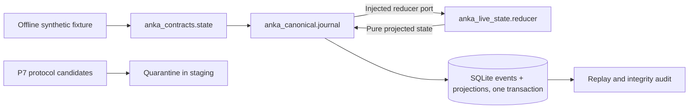

# P8: Durable synthetic journal + deterministic Live State foundation

## Scope and authority

P8 intentionally does **not** promote the historical Dofus 3.7.10.10 protocol research candidates into action-authorizing Canonical events. The P7 staging gate remains unchanged and returns `committed_events=0`. `OfflineStateEvent` is a separate contract and its fixed `SYNTHETIC_FIXTURE_ONLY` origin is never considered live attestation. `state-demo` uses a temporary local SQLite database and does not touch the game.

## Architecture

### Separation rules

- **Contracts** define immutable synthetic events; no protocol imports.
- **Canonical** owns the durable journal, strict ordering, atomic commits, hash chain and replay integrity checks; has no imports of Live State internals.
- **Live State** owns the pure reducer, transition validation and snapshot summary; has no storage or protocol dependencies.
- **Application composition** injects `apply_offline_event` into `SQLiteFixtureJournal`; it is the only code importing both systems.
- **Observability** records metadata-only pass/failure events. It does not own the authoritative journal or alter state.

## Safety and failure controls

1. Invalid events and unrecognized fields fail validation before any journal write.
2. Every session starts with `FIGHT_STARTED`, sequence `1`; new events must be contiguous. Sequence and fight/account generation inconsistencies are rejected.
3. One physical SQLite transaction commits both immutable event and projected state. `BEGIN IMMEDIATE` serializes writers; SQLite WAL with `synchronous=FULL` is used for local durability.
4. A crash or exception before `COMMIT` cannot leave a committed half-event under SQLite's transactional guarantees. Fault injection covers after-event-insert and after-projection-write stages; physical power-loss testing is still pending.
5. On DB opening, replay validates event order, hash links, projection and state digests. Invalid history causes immediate refusal rather than optimistic repair.
6. Read-only audits use one SQLite read transaction so concurrent writers cannot create false corruption diagnoses halfway through an audit.
7. Event payload and state sizes are bounded; audit rejects overlong session history. This phase does not claim high-volume production benchmarking.
8. Exact duplicate deliveries return `IDEMPOTENT_DUPLICATE`. Changed payload with the same ID or a different event with the same sequence is rejected.
9. Snapshots have `actionable=false` and `origin=SYNTHETIC_FIXTURE_ONLY`. No execution authority exists in P8.
10. Neither raw packet bodies nor player secrets are included in P8 diagnostic outputs.

## Commands

| Command | Purpose |
|---|---|
| `state_demo.bat` | Create a temporary synthetic fight, commit seven events, audit and print a summary |
| `state_audit.bat <fixture.sqlite3>` | **Read-only** consistency audit of a P8 synthetic fixture DB |
| `verify.bat` | Full regression suite |
| `start.bat` | Continues to refuse live control with `LIVE_RUNTIME_NOT_IMPLEMENTED` |

Example synthetic state: actor 777, cell 215, HP 2800/3200, AP 11, MP 5, turn owner 777, revision 7. These are test fixtures, not observed current-client values.

## Gates before P9

- [x] Preserve P7 semantic quarantine with no live writes.
- [x] Introduce stable fixture-only state contracts and independent reducer.
- [x] Implement atomic durable event/projection SQLite journal.
- [x] Reject gaps, conflicting duplicates, stale identity generations and invalid turn transitions.
- [x] Detect event/projection corruption and replays that diverge.
- [x] Provide safe CLI demo and audit plus automated fault tests.
- [x] Keep physical game input disabled.
- [ ] Current-build gameplay event certification and independently attested actor/account ownership.
- [ ] Real Canonical admission gate, live transaction owner and actionable state proof.
- [ ] Multi-account synchronized snapshots and real reconnect validation.
- [ ] Power-cut testing and Windows filesystem durability acceptance.

**Important:** P8 passes **offline development acceptance**, not live compatibility or complete mission readiness.
