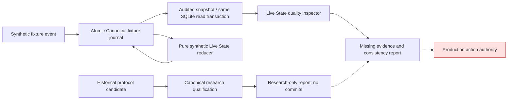

# P9 — Research evidence qualification and synthetic-state quality (offline only)

## Scope, threat model, and outcome

P8 already owns a durable synthetic Canonical ledger and a pure synthetic-state reducer. **P9 does not authorize production Canonical events or game input.** The current project does not have an independently certified adapter for the current Dofus client, process-bound character identity, or complete on-host packet-capture evidence. In particular, the R5.198 mappings labeled **Dofus 3.7.10.10** must not be presented as current-build facts.

P9 establishes diagnostic and fail-closed gates so that future integration cannot mistake a *well-formed value* for an *authoritative fact*. It implements:

1. `src/anka_canonical/qualification.py`: A standalone, bounded, read-only research evidence reviewer; detects build/adapter mismatches, repeated exact evidence coordinates, conflicting values, unknown/partial transport and provisional identity. It exposes **zero** admission, commit or live-action authority.
2. `src/anka_live_state/quality.py`: A pure synthetic snapshot quality assessor reporting missing HP/max-HP/AP/MP/cell/cooldown fields, turn-owner uncertainty, account/process-generation mismatches, stale revisions, invalid actor/HP state and fight-lifecycle mismatches. Even a fully populated simulated snapshot remains **non-authoritative**.
3. `SQLiteFixtureJournal.audited_snapshot(...)`: Audit and snapshot retrieval now occur under **the same SQLite read transaction**, preserving consistency when another process commits a new revision. It does not modify data.
4. `src/anka_app/quality_offline.py`: Composition root for offline, no-input demonstrations and read-only synthetic journal audits. No protocol candidate is converted into a `OfflineStateEvent`.
5. `quality_demo.bat` and `quality_audit.bat`: Diagnostic CLI entry points. The existing Windows batch scripts, JSON configuration, game kernel, calibration, and P8 regression behavior remain unchanged.

## Logical boundaries



## How to run

From Windows, run `quality_demo.bat`. It produces a small synthetic fixture journal in a temporary directory, stages a historical protocol research candidate **only for inspection**, and prints the structured results and diagnostic run directory. It does not access or control Dofus.

To audit a previous synthetic SQLite journal, run:

```cmd
quality_audit.bat PATH_TO_SYNTHETIC.sqlite3 SESSION_ID ACTOR_ID
```

The journal must be a P8 synthetic fixture ledger, not a production DB. A bad journal hash, missing schema, invalid session, or malformed audit will fail closed and produce a sanitized incident report when possible.

All original `setup.bat`, `check.bat`, `verify.bat`, `debug.bat`, `state_demo.bat`, `state_audit.bat` and `start.bat` commands are retained. `start.bat` must still return `LIVE_RUNTIME_NOT_IMPLEMENTED`.

## Qualification invariants

- A protocol payload **never** gains authority merely because it matches the expected build string or its actor and AP/MP values appear sensible.
- `OBSERVED_NO_GAPS` describes the parser's observations, **not** a driver-level guarantee of zero dropped packets.
- `INDEPENDENTLY_OBSERVED` is only an input status for research review; there is no current packet-to-account attestation issuer, so it does not confer authority.
- Each observation key includes build, adapter, flow digest, transport generation, packet number, message ordinal, kind, actor and resource. Repeated observations with conflicting values are quarantined; distinct message ordinals are preserved.
- All P9 qualification outputs are bounded, metadata-only and non-mutating (`committed_events=0`, `live_state_mutated=false`, `actionable=false`).
- A snapshot can be complete for a simulated actor yet remain unfit for planning because no current-build evidence is certified.
- No change was made to the preserved kernel or old reference game-data assets.

## Acceptance and deliberately unverified cases

### Offline acceptance

- The complete P8 regression suite remains passing.
- Added 49 P9 tests covering evidence provenance, duplicate/conflict detection, impossible authority, missing state fields, stale generations/revisions, turn-owner ambiguity, transactional audit snapshot consistency, CLI refusal of live start, and independent imports.
- Full CLI `verify` succeeds in the Linux/Python 3.13 verification environment.
- Fresh extraction and Windows batch execution acceptance remain separately tracked.

### Not certified

- No current-build semantic parser, class/character attestation or driver-level capture completeness proof.
- No actual live Canonical admission, action-authorizing state, or decision input for real fights.
- No live Windows/Npcap or power-failure durability acceptance.
- Nothing here proves the latest Dofus client build behaves like the historical adapter.

## Next milestone

P10 should develop **evidence-backed current-build semantic adapter certification** and an independently testable real Canonical admission owner, but only after obtaining a properly labeled corpus of current-build PCAP/Unity evidence and process/account identity. Otherwise implement further simulation-only contract and fault tests; do not silently promote historical research values. Follow the staged gates: protocol exact build → transport provenance → semantic replay → account binding → Canonical consumer contracts → no-input integrated simulation → Windows read-only acceptance → controlled live acceptance.
