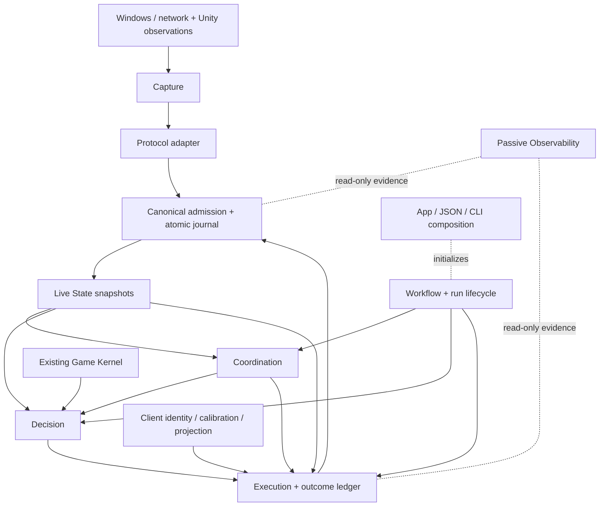
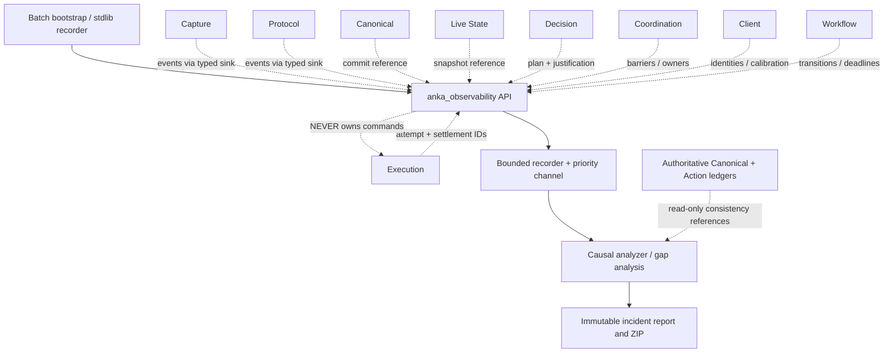
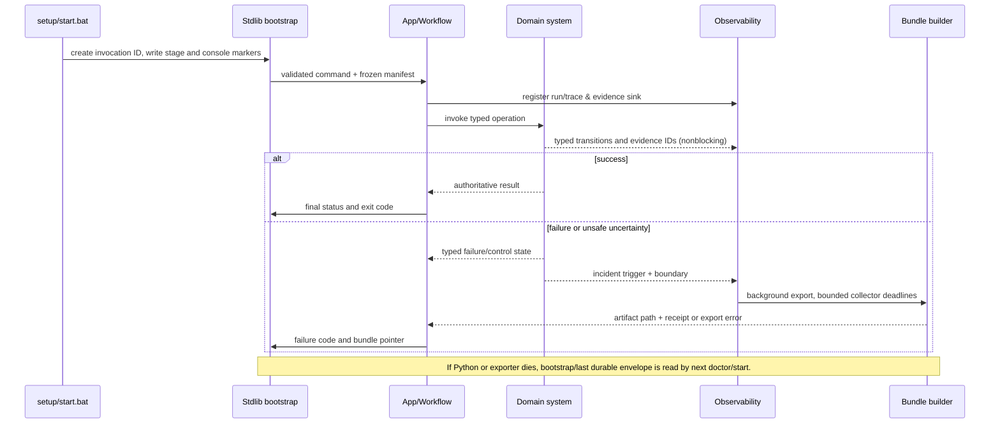

# ANKA NEXT — Final New-Build Architecture and Implementation Plan V2
## Integrated early diagnostics, incident forensics and GPT-friendly evidence (20 October 2026)

**Status:** READY TO BEGIN **OFFLINE DEVELOPMENT** under the V5 architecture; **NOT** certified for current-client live deployment.  
**Prepared:** 20 October 2026; supersedes the planning document dated 19 October 2026  
**Basis:** The exact user-supplied R5.198 lean ZIP, the previously approved V5 architecture, the prior source-reuse plan, new direct source review of setup/start and Observability, selected test execution, and external engineering documentation.  
**Scope:** Inspection and planning only. No ANKA runtime/source code was changed.

> **Major V2 correction:** diagnostics starts at **P0/P1**, not P12. `anka_observability` stays a single isolated runtime package; the stdlib/Batch bootstrap captures failures before the Python environment exists. Each system developed thereafter must deliver its diagnostic coverage *and* behavior tests before acceptance. Full details are in **Part II, sections 13–25**, which form a normative part of this plan.

## 1. Executive decision — what “build from zero” should mean

Create a **new, clean source tree** with the V5 system boundaries and independently owned contracts. **Do not rewrite components that already implement tested, reusable rules.** Copy selected assets with provenance and hashes; wrap mixed-responsibility legacy components through adapters while using them as an offline reference. **Do not copy the old monolithic runtime/Script Studio as the new foundation.**

A clean project means **new application composition and ownership**, **not deletion of accumulated game knowledge**. The project should be developed and accepted **one system at a time**, but each system must be exercised against the next consumer contract and representative full-flow replays—not approved solely because its own unit tests pass.

**Hard limit:** Reusing the code and passing the archived offline tests cannot guarantee that the latest Dofus build, Windows focus rules, Unity plugin, or current captures behave identically. Newly missing semantics must pause the affected capability and produce evidence; never be guessed.

### Decisions that are already settled

- **11 independently organized runtime systems** under `src/` (from V5), plus `anka_contracts` and the `anka_app` composition root. Not 11 processes. No dashboard or Script Studio.
- **Only routinely edited operator file:** `config/user.json` for player names and mission choices, including min/max monsters, stop condition, route selection, and optional overrides. Validated and frozen per run. Versioned data, profiles and calibration are release assets, not new manual forms.
- **Automatic player/window/class identification:** the character name is a *lookup hint*, not proof of class, physical window, or process identity. Use authoritative state + exact process/window/bridge attestation; if not proven, disarm the affected account.
- **Network changes every ~2 weeks:** update a versioned adapter and evidence/fixtures, not the kernel, AI or Windows execution; require exact-current-build capability certification and bounded acceptance.
- **Physical input is a single-writer authority:** never dual-send during old/new comparison; never blindly retry an ambiguous mouse or key send.
- **One atomic canonical commit/state history authority:** do not split a database transaction or duplicate state authority merely to gain separate directories.
- **Verification Lab is development infrastructure, not a runtime microservice**; every confirmed incident should become a permanent regression.
- **Mandatory diagnostic foundation from P0/P1**: every command is traced, failure reports are generated locally, and each new system exposes typed evidence. Human-readable GPT incident ZIPs require evidence manifests and sanitization; one observer may not own gameplay safety.

## 2. Reusable source inventory — audited against R5.198

| Existing source/asset | Concrete contents seen | Proposed ownership | Reuse strategy | Qualification required |
|---|---|---|---|---|
| `src/anka_game_kernel/` | **136 Python files**; `api/kernel.py` exposes `GameKernel` with geometry, LoS, AoE, range, movement, collision, target/cast, fight and spell-readiness services | `anka_game_kernel` | **Preserve nearly unchanged.** Copy complete package and independent unit tests, then expose a narrow read-only query port | Determinism, current rulepack/static compatibility, same rule outputs on saved cases |
| `src/anka_game_kernel/data/spell_mechanics/verified_spells.json` | Packaged verified-spell mechanics | Kernel release data | Copy with hash and provenance; keep rulepack distinct from protocol version | Verify required CRA/ENU loadouts and grades; do not invent missing values |
| `gamedata/Static/` and `gamedata/Mapuse/` | Static spells, breeds, monsters, effects, map definitions; **4 bundled Mapuse map files** | Kernel immutable data asset | Reuse bundled files; record coverage by required map and feature | Do not claim full-game map coverage; exercise actual patrol maps and fight overlays |
| `gamedata/COMPATIBILITY.json` | Declares source-game data `3.6.10.10`; configured automation subset compatible offline with `3.7.10.10` | Kernel data certification | Keep as evidence, not proof of modern full-client compatibility | Re-evaluate if spells, effects, maps or client build change |
| `defaults/shared_ui_calibration_1280x649.yaml` | Verified 22 spell-slot points, `PHASE_BUTTON` (Ready/End Turn), `JOIN_FIGHT`, four world directions at 1280×649 | `anka_client` versioned data | **Reuse numeric coordinates**, convert once to normalized JSON release asset with metadata and hashes. No recalibration by default | Verify live size/DPI, window-specific client geometry, phase, focus, and runtime display scaling. The same phase button must never be interpreted without state proof |
| `src/anka_platform/calibration/models.py` | Validated point/profile schema; `READY` and `END_TURN` alias to `PHASE_BUTTON` | `anka_client/calibration` | Preserve validation semantics; remove dependency on mutable legacy YAML operator config | Negative tests: missing button, wrong size, coordinates out of bounds, invalid phase |
| `src/anka_platform/projection/` | `ProjectionService`, `HttpUnityProjectionBridge`, `ProjectionObservationSynchronizer`, bridge-readiness and cell resolution | `anka_client/projection` | Reuse proven projection/attestation algorithms via a new public port, **not whole old runtime dependencies** | Test map/generation identity, actor/cell association, stale bridge, wrong DPI, unwalkable target |
| `unity_bridge/` | BepInEx IL2CPP C# source, runtime 560-cell discovery and local `127.0.0.1:8765` service | Client native adapter (out-of-`src/` source asset) | Carry C# source with provenance and existing source-verification test. Internal loopback HTTP is **not** a dashboard | Build/install and run on the user's Windows client; verify real map source + actor association; unavailable in this Linux offline review |
| `src/anka_platform/execution/windows.py` | Win32 identity/focus/control methods (one large ~1,897-line file) | `anka_client` for identity/focus and `anka_execution` for input driver | **Extract narrow tested components**, not the entire class as an architectural dependency | HWND→PID→creation-time, wrong-window rejection, focus loss, DPI, before-DOWN proof |
| `src/anka_platform/execution/control_authority.py`, `arbiter.py`, `settlement.py`, `pointer_motion.py` | Existing control lease, arbiter, outcome settlement and pointer path | `anka_execution` | Preserve specific safety algorithms after contract isolation; do not blindly port the ~7,998-line `ExecutionService` | Fault-cut test after prepared/sent/uncertain; no duplicate input; AP/MP and turn outcome confirmation |
| `src/anka_platform/capture/` | Capture transport/flow ownership and PCAP decoding helpers | `anka_capture` | Selectively move pure framing/stream and process-binding logic | Fragmentation, flow takeover, packet gaps/reconnection, bounded queue |
| `src/anka_platform/protocol/` | Version-local adapters `3.6.10.10`, `3.6.12.16`, `3.7.10.10`; SDK/qualification and strict opaque-wire handling | `anka_protocol` | Reuse adapter implementations as **historical replay authorities**; extract version-independent SDK into new package | New active adapter must match the observed build, with current-build positive/negative/scenario evidence |
| `src/anka_platform/live_state/{reducer.py,store.py}` | Existing reducer and SQLite persistence/checkpoint/transaction methods | `anka_live_state` and one canonical commit authority | Reuse reducer semantics and **preserve atomic writer arrangement**, then wrap with immutable snapshots | Event ordering, rollback/reopen, freshness fields, duplicated/delayed turn evidence |
| `src/anka_platform/core/fight/` + `fight_ai/` | Decision frames, policy invocation, planners, CRA/ENU strategies, action quarantine | `anka_decision` | Retain tactical rules and class policy behavior; strip coupling to legacy runtime and fix codec boundary | Same input frame -> stable legal plan; no rejected-plan loop; passive/no-action works |
| `src/anka_platform/party/` and `campaign/` | Join/Ready/turn barriers; run budgets, fight transitions and reentry | `anka_coordination` and `anka_workflow` | **Rebuild authority wiring**; reuse pure state machine rules/transition logic through tests | Single turn owner; CRA→ENU handoff; no unbounded READY wait; victory counted once |
| `src/anka_platform/observability/`, `simulation/` | Incident export, event journals, offline no-input systemic scenarios, failure diagnosis | `anka_observability` and `tests/lab` | Reuse forensic schemas, scenarios and diagnostic classification; build early stdlib bootstrap + passive bounded recorder from P1 | First-divergent-boundary report, lag stress, reproducible and share-safe GPT incident ZIP |
| `src/anka_platform/web/`, Studio, web server bootstrap | Dashboard, UI forms and HTTP orchestration | **No new web system** | **Do not port UI.** Extract essential session/mission logic into `anka_app`/Workflow first | New JSON/CLI can launch, stop, recover and diagnose with full mission parity |

### Important distinction: present in ZIP vs currently operational

- **Existing calibration points are real archived assets**, not an assertion that they still align after resolution/DPI/UI updates. Their label `verified: true` records *past* verification.
- Player profiles identify `Curseni` as Cra and `Sosoking` as Enutrof, but the legacy `profiles/players.yaml` uses title hints; current-client identity must be independently attested before input.
- `R5_198...md` documents observed **client 3.7.11.11** while the active adapter is **`dofus_3_7_10_10`**. That is explicitly **not an exact-build certification**. The compatibility document scopes old static data to a subset; it is not complete game-data compatibility.
- The lean ZIP has **no raw `.pcap`/`.pcapng` or SQLite journal files**. It includes decoder fixture/config/test material and written incident findings, but not every piece of primary live evidence. Missing original evidence cannot be reconstructed by guessing.
- C# bridge compile/install, live UI input, Windows process matching and a complete CRA→ENU fight cannot be proved in this offline environment.

## 3. Tests independently executed in this planning review

On extracted source with Python **3.13.5** and `PYTHONPATH=src`; the reference source was not modified:

1. **70 passing targeted tests** across static spells, range, LoS, spell readiness, calibration, window-identity continuity, map projection, R5.198 and R5.192 protocol qualification: `70 passed in 7.28s`.
2. **14/14 systemic simulation scenarios:** `overall_status=PASS`, `physical_input_emitted=False`.
3. Existing `tools/verify_protocol_upgrade_contract.py`: `PROTOCOL_UPGRADE_CONTRACT=READY`, **four live scenario categories remain pending** (`END_TURN_TO_NEXT_OWNER`, `FIGHT_END_TO_WORLD_REENTRY`, `PLACEMENT_TO_READY`, `READY_TO_FIRST_TURN`). This structural READY is **not** a live-pass label.
4. Existing `tools/verify_release_integrity.py --sealed`: `RELEASE_INTEGRITY=READY`.
5. Existing `tools/verify_engineering_guardrails.py`: `ENGINEERING_GUARDRAILS=PASS`.

This is **targeted evidence**, not a claim to have rerun the complete R5.198 test corpus or validated V5's as-yet-unwritten implementation. Actual test outputs are not proof of the future project.

## 4. Clean target layout and ownership

```text
ANKA_NEXT/
├── src/
│   ├── anka_contracts/        # one stable vocabulary, immutable DTOs, codecs, public ports
│   ├── anka_capture/          # 01 packet streams, flow/PID correlation, transport gaps
│   ├── anka_protocol/         # 02 versioned adapter, wire->candidate, drift qualification
│   ├── anka_canonical/        # 03 semantic admission, single journal writer/cursor
│   ├── anka_live_state/       # 04 deterministic reducers, freshness, pinned snapshots
│   ├── anka_game_kernel/      # 05 existing kernel preserved; rules and static knowledge
│   ├── anka_decision/         # 06 CRA/ENU policies, legal candidate planning, quarantine
│   ├── anka_execution/        # 07 admission, one input lease, action ledger and settlement
│   ├── anka_coordination/     # 08 roster, same-fight coherence, Ready/join/turn permits
│   ├── anka_workflow/         # 09 run plan, mission lifecycle, progress/recovery/stop
│   ├── anka_client/           # 10 process/window/class attestation, calibration, projection
│   ├── anka_observability/    # 11 non-blocking traces, first-cause incidents, metrics and forensic bundles (starts P1)
│   └── anka_app/              # CLI, strict JSON, bootstrap diagnostics, wiring, lifecycle owner
├── config/
│   ├── user.json              # the only routinely edited config file
│   └── schema/               # shipped JSON validation schema
├── assets/
│   ├── game_data/            # immutable static/Mapuse, provenance and version manifest
│   ├── class_profiles/       # certified CRA/ENU gameplay loadout/profile data
│   ├── calibration/          # imported 1280x649 verified baseline + validation metadata
│   └── protocol/             # independent versioned fixtures/manifests
├── native/unity_bridge/      # original C# plugin source with retained license/provenance
├── tests/
│   ├── unit/<system>/
│   ├── contracts/<provider>/<consumer>/
│   ├── integration/<boundary>/
│   ├── replay/<incident_id>/
│   ├── lab/                  # virtual clock, no-input driver, fault/crash injection
│   └── windows_acceptance/   # deliberately gated physical-client checks
├── tools/                    # verify, doctor, protocol-qualify, incident inspection and bundle validation
├── runtime/                  # generated bootstrap traces, per-run evidence and sanitized incidents
├── setup.bat  check.bat  start.bat  stop.bat  doctor.bat  debug.bat  verify.bat  replay.bat
└── pyproject.toml            # locked validated dependencies / Python 3.13 target
```

Every runtime system exposes a deliberately small `api.py` or contract port. `anka_contracts` cannot import concrete owners; `anka_game_kernel` remains independent of `anka_platform`, Windows and live networking; `anka_decision` does not import input drivers; `anka_execution` cannot import tactical policy internals. One process is initially preferred. Native bridge is a bounded local component; no public dashboard or web server required.



*The `Execution → Canonical` arrow is **not** an invented game-state mutation: execution publishes local intent/attempt metadata and receives authoritative effects only through Canonical evidence. Physical outcomes remain uncertain until corroborated. The application wiring orchestrates subscriptions and state readers to avoid circular imports.*

## 5. Planned operator configuration and automatic class selection

Example **illustrative proposed schema**, not a runnable current-R5.198 file:

```json
{
  "schema_version": 1,
  "players": [
    {"name": "Curseni", "role": "leader"},
    {"name": "Sosoking", "role": "follower"}
  ],
  "mission": {
    "route_id": "sufokia_direction_cycle",
    "min_monsters": 6,
    "max_monsters": 8,
    "target_wins": 5,
    "max_attempts": 10
  }
}
```

Validation is strict, including **duplicate JSON keys**, unknown properties, invalid min/max, conflicting roles and unsupported profiles. At startup discover live Dofus processes/windows; match the named character to authoritative game/bridge/flow evidence, verify live character class and spell loadout, then select the certified CRA/ENU policy. The class must **not** be deduced exclusively from the name or title text. An unknown class or ambiguous window must produce a typed `IDENTITY_NOT_VERIFIED`, not a guessed click.

Calibration release data is internal; the user should not re-enter 22 spell coordinates or Ready/End-Turn positions. When a window changes size, DPI, bridge generation or verified class/slot binding, pause that client until a calibration/projection gate passes. An optional **CLI calibration command**, not a dashboard, may repair an invalidated baseline.

## 6. Critical cross-system invariants: reasons we are rebuilding the wiring

1. **One current run ID; one exact client/process generation; one action authority per controlled account.**
2. **Packet and event provenance:** no guessed account, source or canonical meaning; transport gaps are explicit.
3. **Canonical commit consistency:** apply adapter context + committed event sequence under one recoverable transaction boundary, preserving state/cursor/checkpoint rules.
4. **Evidence freshness:** correct *causal* floors and fight/turn epochs; arrival order alone cannot reject valid AP/MP evidence or certify stale evidence.
5. **Decision correctness:** immutable same-fight frame; the kernel proves action legality; rejected `ActionKey` is not replanned forever against unchanged state.
6. **Execution safety:** one durable pre-send record; focus/window/projection recheck immediately before mouse-down; ambiguous sent actions never retried without new authority.
7. **Liveness:** WAIT is typed, bounded by state-appropriate deadlines and progress evidence. Failure must not cause silent infinite Ready/end-turn loops.
8. **Protocol independence:** exact new-build adapter proof; uncertain gameplay-critical fields disable relevant capabilities instead of mutating kernel/AI logic.
9. **Observability isolation:** recording/report export may lag or fail without blocking critical state capture or corrupting game progress. The durable canonical/action ledgers remain authoritative; report evidence gaps, never falsely claim full tracing.
10. **Every corrected historical failure becomes a reproduced negative test and successful-recovery test**, with independently defined expected output.

## 7. Build sequence: deliver one system, prove it, then proceed

| Gate / stage | Work in the new project | Required evidence before moving on | Reusable source |
|---|---|---|---|
| **P0: Freeze baseline + diagnostic inventory** | Hash ZIP; catalog rules/data/calibration/incidents and every setup/start/fight failure entry; define typed event inventory and evidence expectations | Immutable inventory, reproducible test commands, clear historical-vs-current acceptance labels | All archive as **read-only reference** |
| **P1: Contracts + Lab + early diagnostics** | Implement DTOs/codecs/identity, stdlib/Batch bootstrap recording, typed event/failure schemas, minimal bounded forensic recorder, fake-incident bundle, virtual-clock no-input/fault lab | Consumer/provider contract tests, deliberate mutants caught, 0 physical input, no unauthorized dependencies | Existing action/reducer semantics and 14 systemic scenarios |
| **P2: Existing Kernel** | Copy full kernel package and selected game-data packs, preserve API and exact rulepack hashes; add pure query facade | Existing tests pass unchanged; deterministic LoS/range/movement/AoE/cast parity; explicitly scoped data coverage | `anka_game_kernel`, `gamedata`, verified spells |
| **P3: Client + calibration** | Import calibrated points into immutable JSON release profile, wrap Unity projection, OS inventory and generation proof | All 22 slots + phase/join controls resolve; wrong PID/window/size/map/cell fails safely; mock Windows and bridge tests | Calibration, Projection, Win32 safe interfaces, C# plugin |
| **P4: Capture** | Build transport stream ownership and gap detection, independent of Protocol implementation | Old/new framing and flow parity on fixtures; split/reorder/drop and reconnect injections; bounded queue | Capture modules |
| **P5: Protocol** | Extract SDK and versioned adapters; separate current vs historical evidence; qualify new exact client build | Candidate replay yields expected canonical candidates; unknown critical drift fails; consumer tests pass; adapter can roll back | Versioned adapters, catalogs and upgrade checkers |
| **P6: Canonical journal** | Single durable writer and admission; define committed cursor, decoder-context restore | SQLite crash cuts and duplicates/reorder tests; no accepted event lost/duplicated, checkpoint parity | Existing Canonical state store and journal semantics |
| **P7: Live State** | Deterministic reducers, world/fight geometry overlays, freshness/provenance; immutable snapshots | Recorded actor/HP/AP/MP/cell/turn evidence parity; stale/late state rejected or properly admitted; restart replay | Reducer, world/fight models |
| **P8: Decision** | Move CRA/ENU policies behind one frame/plan interface, kernel validation, budgets, ActionKey quarantine | Legal action parity; no infinite same-key resubmission; no access to mouse/Win32 or raw wire structures | FightAI, core fight contracts/policies |
| **P9: Coordination** | One roster + fight-epoch + Ready/join/turn barrier and permits | Controlled CRA↔ENU lifecycles with late, duplicated and missing signals; only proper turn owner acts | Party barriers, team evidence |
| **P10: Workflow** | JSON-driven mission compilation, patrol, encounter, victory budget, bounded waits, reconnect/re-entry | World→join→Ready→combat→reentry replay; victory counted once; run can stop and resume safely | Campaign, mission rules, runtime lifecycle |
| **P11: Execution** | Exclusive input owner, action admission, pointer/Win32 driver, durable attempt/settlement state | No duplicates after crash or timeout; wrong focus/geometry fails before DOWN; ACK ≠ authoritative settlement; mock->bounded Windows acceptance | Control authority, arbiter, settlement, pointer/window driver |
| **P12: Final App + diagnostic integration** | Harden already-existing early observer/incident export, privacy/size/integrity verification, complete CLI/Windows setup/start/doctor and end-to-end failure tests | Single-command setup/start/verify; no web/Studio dependency; root failure exported; complete offline gates | Diagnostics, selected installer/verification scripts |
| **P13: Current-build acceptance** | Finish exact-client adapter and Windows bridge, run one bounded 2-account fight with explicit checkpoints | First spell continues, CRA→ENU handoff, ENU confirmed action, fight outcome/world re-entry; no first-cause blocker | New runtime + current authorized live evidence |

**Important sequencing:** a fake/no-input `anka_app` composition is created as soon as P1 starts so each subsequent system can be tested end-to-end without physical input. P12 denotes final hardening and delivery, **not** first appearance of App. The real input driver is wired **last**. Coordination and Workflow can be incrementally built earlier if a test needs their port; the activation gate stays owner-specific.

**One-system policy:** implement source + unit tests + consumer contracts + relevant adversarial cases + integration replay; publish one receipt. Do **not** implement five systems and rely on a single final test to find coupling problems. Compare semantic outputs to legacy under the *same inputs*; document intended corrections rather than copying historical defects.

## 8. Minimum historical regression corpus to preserve

| Incident family | Failing assumption in prior code, as documented | Permanent offline test expected |
|---|---|---|
| R5.142 action contract | Action serialized differently across AI/Execution boundary; rejected-plan loop | Exact planned command stays equivalent after codec; same rejected frame cannot spawn endless repeats |
| R5.151 confirmation | Delayed outcome escalated into global control disarm | Pending/unknown remains scoped; progression only with proof; eventual result settles correctly |
| R5.195 fight placement | Static map walkability overrode current fight geometry | Current-fight evidence wins within its scoped epoch; invalid map generation fails |
| R5.196 AP/MP freshness | Valid earlier-current-turn evidence deemed stale by an incorrect timestamp floor | Both positive and negative freshness tests with controlled ordering |
| R5.197 startup control | Previous process/port ownership made safe replacement fail | Exact run owner recognized; stale/foreign process refused or safely recovered |
| R5.198 protocol drift | Unknown `icw`/`icl` caused sticky global unclassified health after settled CRA cast | Exact verified opaque bytes admitted without fake mutations; changed fingerprint blocks affected capabilities and exports incident; fight continues on known-safe stream |
| Historic Ready/handoff | Both appear Ready yet active turn never progresses | Simulated late/double Ready and first-turn ownership converge or produce bounded diagnostic, never silent stall |
| Historic cell/focus issues | Unwalkable/illegal target or focus switch before click | Before-DOWN full proof; rejected attempt yields zero input; no guessed movement/target |

When actual raw capture/journal evidence is absent, a **derived reconstruction** must be labeled `DERIVED_REGRESSION`, not passed off as authentic primary replay. Use independent hand-written expected outputs and negative variants so the new code cannot validate itself against the same mistaken assumptions.

## 9. Exact readiness gates — no arbitrary quality percentage

**Ready for engineering P0/P1 now:** yes, because the source, V5 design, calibration/game data, selected passing tests, and key legacy APIs are available. No further architecture debate is necessary before beginning this bounded foundation work.

**Before P3/P5 live-bound modules can claim current-client readiness:** obtain/confirm the active build and exact process/window/bridge calibration on Windows, current-build raw packet evidence (or newly collected reproducible captures) and live event/turn progression. Historical `3.7.10.10` qualification **must not be silently relabeled** for an observed `3.7.11.11` or later build.

**Before activation of each system:** one authoritative owner, public contract conformance, explicit failure cases, old/new parity or justified semantics change, independent test oracle, bound import dependencies, recorded reproducible receipt. Failed or skipped gates cannot be counted as PASS.

**Before full new project release:** run full relevant test corpus and controlled fault matrix on exact packaged ZIP; verify installed-vs-source coherence on Windows; bounded current-client CRA+ENU acceptance; sign results as separate `OFFLINE_VERIFIED` and `LIVE_ACCEPTED` statuses.

### Explicitly not yet proven

- Exact-current-build protocol completeness, absent source capture/SQLite incident data.
- Unity bridge installation/build and automatic class/character attestation in the present Windows environment.
- Real pointer focus, slot targeting and calibrated coordinate validity on the user's current resolution/layout.
- End-to-End live Ready→first turn, CRA→ENU handoff, ENU cast/MP, fight end and world reentry.
- The new V5 implementation itself—it has not been coded or tested.

## 10. Definition of the first development deliverable

**First deliverable after authorization: an `ANKA_NEXT` project ZIP containing only a clean foundation with early diagnostics**, not a premature “complete bot” claim:

1. The isolated `anka_contracts` package, typed codecs/ports and architecture dependency tests.
2. A new `anka_app` CLI accepting strict JSON with the proposed `config/user.json` schema; `check` and `verify` work fully offline, and each launcher writes bootstrap evidence before imports.
3. Imported unchanged `anka_game_kernel` and selected versioned immutable data, plus matching passing tests and provenance manifest.
4. `tests/lab` with deterministic fixtures, virtual clock, no-input driver, first incident regressions and receipts tied to source/fixtures hashes, including malformed setup and intentionally triggered incident.
5. `setup.bat`, `check.bat`, `verify.bat`, `doctor.bat` and `debug.bat` with bootstrap/doctor support, **no** dashboard and no physical input; one verified sanitized GPT-friendly ZIP from a fake failure.
6. A `REUSE_MANIFEST.json` recording every copied path, original hash, current hash, changed/unchanged classification, and current client-certification status.
7. A detailed evidence report enumerating PASS/FAIL/SKIP/MISSING_EVIDENCE, including diagnostics coverage and bundle integrity, so future milestones never require rediscovering the same reference project.

Only after this stage passes should the Client/Capture/Protocol/etc. systems become active one by one. **The original R5.198 project remains untouched and available as the reference baseline.**

## 11. Engineering references used for risk-based choices

- [Martin Fowler, Strangler Fig Application](https://martinfowler.com/bliki/StranglerFigApplication.html): new ownership and contracts should replace legacy behavior incrementally, not through one big-bang rewrite.
- [SQLite, Atomic Commit](https://www.sqlite.org/atomiccommit.html): the canonical journal transaction and checkpoint boundary requires deliberate crash recovery validation.
- [pytest fixtures](https://docs.pytest.org/en/stable/explanation/fixtures.html): use deterministic and independent fixtures/ports for meaningful negative and integration tests.

**Final decision: READY TO START THE FIRST OFFLINE DEVELOPMENT MILESTONE. NOT READY TO CLAIM LIVE PRODUCTION COMPATIBILITY.**

## 12. Additional configuration-precedence risk identified during the final pass

The archived `config.yaml` contains not just operator preferences but **15 root sections** (`kernel`, `protocol`, `runtime`, `web`, `execution`, `reliability`, `projection`, `scripting`, `capture`, `party`, `patrol`, `run_budget`, `fight_ai`, `calibration`, plus schema version). Existing `fight_ai.profiles` contains CRA/ENU spell lists, not merely a class name. **Do not delete these technical values without first assigning them to certified package defaults or a runtime policy.** The new operator-facing JSON stays small; internal release assets preserve the necessary complexity.

There is a concrete **source-of-configuration mismatch** requiring a parity test: `missions/sufokia_farm_tactical_v1.yaml` declares `target_wins: 5`, `max_attempts: 10`, `stop_on_loss: false`, `stop_on_unknown: false`, while `config.yaml` declares `target_wins: 5`, `max_attempts: 5`, `stop_on_loss: true`, `stop_on_unknown: true`. The final effective run depends on mission-selection and override precedence. **Before shipping the new JSON compiler, reconstruct the exact legacy precedence from `SessionCompiler`/application launch, then define one explicit new precedence rule and snapshot its resolved output.** Do not silently assume either file is the historical runtime truth.

The current `fight_ai` configuration contains `verify_live_spell_slots: true` **and** `allow_profile_spell_bar_fallback: true`. New-build policy must distinguish a certified same-build fallback from an unverified guessed slot. The stored 22-point coordinate profile says where to click a slot; it does **not** by itself prove which spell currently occupies that slot. Current-client action admission must verify the spell-to-slot assignment or fail closed.

The legacy window profile includes title matching and activation hotkeys. Those are useful discovery hints, **not** authorizations to send input. A new name-only setup still requires validated live class, character ID, PID creation time, window HWND and calibration/bridge generation before arming.

**This extra audit does not delay P0/P1.** It adds three mandatory consumer parity cases to the first JSON/Client milestones: run-budget precedence, spell-slot meaning versus click-coordinate placement, and account-name/class/window identity provenance.

---

# PART II — NEW: End-to-end diagnostics and failure-analysis architecture (mandatory, from P0)

## 13. Decision after falsifying the proposed “track everything” solution

**Final architecture choice:** retain exactly **one `anka_observability` runtime system**, add a **stdlib-only bootstrap recorder** owned by `anka_app`, and maintain the **offline Verification Lab** as test infrastructure. Do **not** add a second debug microservice, duplicate gameplay journal, live AI-based autonomous debugger, public dashboard, or database per subsystem.

The phrase “track everything” is an operational objective, **not** a safe implementation specification. Saving all packet bodies, every pointer interpolation, repeated unchanged state snapshots, credentials, and every successful health poll would create disk/CPU pressure, privacy risks and misleading evidence. Instead:

1. **Capture every important *transition and decision boundary*** as a typed event, with identity, cause and timing.
2. Preserve exact durable gameplay truth in its **owning systems** (`anka_canonical`, `anka_execution`, and release manifests)—do **not** create a rival “truth database” in Observability.
3. **Always record** setup/launch stage changes, errors, safety fences, session/crash ownership, canonical commit cursor, decision inputs/outputs, physical attempt lifecycle and outcome confidence.
4. Use a **bounded in-memory flight recorder** plus short persistent structured streams, with debug detail elevated only on anomaly or explicit opt-in.
5. Build a **single, deterministic, privacy-sanitized diagnostic bundle** and human-readable + machine-readable reports after significant failures. A first-cause hypothesis must always cite evidence IDs and show gaps.
6. Make tracing **passive**: exception in a collector never grants/revokes physical authority, commits Canonical data, repeats input, or changes AI plans. Safety owns safety; diagnostics explains it.
7. **Verify instrumentation itself:** deliberately introduce failures at every lifecycle stage and prove diagnosis/recording and exit behavior.

The system cannot *prove* root cause without sufficient evidence. It must prefer `UNDETERMINED` or `MULTIPLE_PLAUSIBLE` to a confident but unsupported answer. It cannot guarantee all future failures disappear, but it can make unexplained failures increasingly rare and convert each confirmed incident into a test.

### Reuse audit, against the actual R5.198 source

| R5.198 reference | Evidence actually found | Recommendation | Remaining risk / new required test |
|---|---|---|---|
| `observability/incident.py` | `IncidentManager.trigger`, asynchronous worker, deduplication, synchronous minimal crash envelope, optional safety-freeze callback | Reuse the **concepts** and selected proven logic, not the legacy safety callback as a cross-system authority | Simultaneous incidents, queue overflow, mid-export termination, repeated failure during dedup, missing/partial crash envelope |
| `observability/journal.py` | SQLite tables for action attempts, event diagnostics, protocol traces; correlation includes session/run/action/account/flow/fight/revision | Preserve schema learnings and correlation; one schema-versioned evidence API | Journal inaccessible/disk full/multiple writers; metrics about missing events; never confuse diagnostic DB with canonical transaction |
| `observability/diagnostics_v2.py` | Collectors, `BoundaryObservation`, `RootCauseGraph`, `evidence_gaps`, per-collector status | Reuse classifier structure; insist that suggested root is **hypothesis with proof links**, not fact | False attribution, collector timeout, stale unrelated previous-run evidence, circular interpretation |
| `observability/exporter.py` | `DebugBundleExporter` with correlated events, PCAP manifest, startup/bridge sections, root-cause analysis and ZIP | Retain section inventory and artifact concepts; split giant exporter into small isolated collectors + deterministic assembler | ~4,249-line implementation has many responsibilities; broad assembly must not run on critical input loop; missing/corrupt sections must show explicitly |
| `observability/run_store.py` | Per-run JSONL streams (`event`, `decision`, `action`, `health`, `failure`) and run registry | Adopt append-only structured run records, but unify envelope and IDs | Duplicated representations or unbounded growth; file writes can fail |
| `observability/startup_diagnosis.py`, `startup_debug.py`, `start.bat` | Dedicated startup export; `start.bat` calls an exporter on selected failures | Reuse proven fallback idea; attach recorder **before any Python/venv-dependent step** | Missing Python, corrupted venv, invalid working directory, launcher dies before exporter can run |
| `setup.bat`, `tools/export_setup_failure_debug.py` | Stage marker, dependency install log, stdlib ZIP export | Preserve stdlib-only fallback and stage identity | ZIP may include external installer logs/paths: require share-safe redaction, no raw leak assumption |
| `tests/observability/*`, `tests/r5177/*`, `tests/r5193/*`, `tests/platform/test_startup_debug.py`, `test_r5_debug_cli.py` | Existing scenario and diagnostic regression suite | Port scenarios and expand destructive tests | Passing preexisting tests is not certification of redesigned system |

**Independent review check (20 October 2026):** the selected archived observability, startup and diagnosis suite was executed with `PYTHONPATH=src pytest -q -p no:cacheprovider ...`; **85 tests passed**. This establishes historical test behavior, not the new design's correctness or fresh Windows/client compatibility. The source ZIP contains no raw current-build PCAP/SQLite runtime evidence, so no genuine new live diagnosis was reproduced in this review.

### Falsification of naive alternatives

| Hypothesis | Result | Reason |
|---|---|---|
| “Log every packet and mouse micro-step permanently” | **Reject** | Performance, disk use, security, irrelevant noise; opt-in sampled/raw forensic mode only |
| “Make a separate diagnostic microservice” | **Reject initially** | Increases deployment failure surfaces without a demonstrated need; independent package and optional exporter worker are enough |
| “Make every system write to one shared SQLite connection” | **Reject** | Hidden coupling, blocking, possible contention; read-only event sink via bounded queue and separate observational store |
| “Export ZIP synchronously whenever a failure occurs” | **Reject** | Can freeze action loop or hide primary failure; minimal envelope first, heavy export afterward |
| “Diagnosis may automatically fix/retry gameplay” | **Reject** | Observability should not own unsafe side effects; it issues diagnostic findings only |
| “Only need failure logs” | **Reject** | Must preserve decisive **success** evidence and expected progress before/after failures to find earliest divergence |
| “Separate logs from gameplay proof entirely” | **Partially reject** | Observation is separate, but bundle needs **read-only references** to committed canonical events, durable action ledger and exact build manifest |
| “All logs should fit in one file” | **Reject** | Bootstrap/startup/fight evidence have distinct retention and criticality; use one schema and coordinated bundle, not one enormous file |
| “GPT-friendly means free-form prose only” | **Reject** | Need deterministic machine-readable schemas, stable evidence IDs, and an authored explanatory summary; GPT interpretations are secondary |

## 14. The precise package boundaries, ports and storage

The 11-system architecture from Part I **does not gain another runtime system**. Diagnostics is cross-cutting instrumentation supplied by one owner, not a reason to let code import each other's internals.

```text
src/
  anka_contracts/
    diagnostics.py             # DiagnosticEventV1, EvidenceRef, FailureFinding, ArtifactRef
    health.py                  # HealthStatus + failure/control-state semantics
    ports/diagnostics_sink.py  # emit(event) -> admission outcome; never returns gameplay commands
  anka_observability/          # independent runtime system, NO business-policy imports
    api.py                     # recording facade + read-only query + export request
    model/
      events.py                # typed envelopes and schema migration
      context.py               # run, phase, actor, account, trace/span and attempt IDs
      failure_registry.py      # stable failure categories, owner/boundary mapping
    ingestion/
      validation.py            # reject oversized/bad payload, preserve explicit loss counter
      redaction.py             # allowlist and field-aware redaction before persistence
      queue.py                 # bounded nonblocking delivery
      priority.py              # failure/settlement evidence vs routine debug
    recorder/
      run_store.py             # per-run journal (observational only)
      flight_recorder.py       # bounded per-account and global pre-incident windows
      emergency.py             # tiny crash envelope, safe fallback path
      integrity.py             # hashes, dropped count, clock/sequence verification
    correlation/
      timelines.py             # causal trace per setup/mission/fight/action
      boundary_graph.py        # expected vs observed transitions, typed edges
      causal_candidates.py     # hypotheses with evidence links and contradiction checks
    collectors/
      setup.py  startup.py  environment.py
      identity.py  capture.py  protocol.py  canonical.py
      live_state.py  kernel.py  decision.py  coordination.py
      execution.py  workflow.py  client.py  storage.py
    watchdogs/
      progress_observer.py     # observes owner deadlines, never controls them
      telemetry_health.py      # queue loss, collector lag, disk space, last good heartbeat
    incidents/
      trigger.py  dedupe.py  evidence_scope.py  findings.py
      schema_validation.py  bundle_builder.py  manifests.py
    exporters/
      gpt_report.py            # structured + concise readable files
      zip_export.py            # immutable, checksummed, share-safe archive
      retention.py             # budgets, pinned incidents, safe cleanup
    testsupport/               # optional pure test fixtures, no live runtime ownership
  anka_app/
    bootstrap/
      early_record.py          # Python stdlib-only; no third-party imports
      process_envelope.py      # setup/start/stop invocation, command, exit and stderr
      unhandled_errors.py      # Python exception, signal/exit markers
    cli.py                     # check/doctor/start/stop/verify/debug/protocol-qualify
    lifecycle/
      recovery_scan.py         # orphan runs, killed process, incomplete setup/install
    wiring/
      diagnostics_wiring.py    # inject `DiagnosticsSink` to each owning system

tools/
  diagnose_run.py              # reads immutable bundle; no runtime effects
  verify_diagnostics.py        # diagnostics self-tests and sabotage suite
  export_setup_failure.py      # stdlib-only fallback
  export_incident.py           # CLI post-mortem and bundle validation
  replay_incident.py           # reusable incident test case, no real input

runtime/                       # generated; never shipped as proof of certified build
  bootstrap/                   # created by .bat before Python installed
    <invocation_id>/console.log, bootstrap.json, stage.json
  runs/<run_id>/
    run_manifest.json          # release/adapter/rulepack/config hashes, capabilities
    journal/events.jsonl      # observational records, schema ID, seq, clock fields
    journal/priority.jsonl    # failure/safety/attempt lifecycle retained first
    captures/                 # opt-in raw protocol evidence, separately labeled
    state_refs/               # committed revision + optional bounded snapshots
    incidents/<incident_id>/
      envelope.json            # written as early as feasible
      manifest.json            # artifact presence/checksum + missing evidence
      diagnosis.json           # findings, hypothesis rank, corroboration, gaps
      GPT_READ_FIRST.md        # readable explanation and next diagnostic question
      timeline.jsonl           # precise causal timeline
      files/                   # sanitized collected evidence, optional dumps
      share_bundle.zip         # intentionally sanitized; opt-in raw excluded
  diagnostics/latest.json      # pointer only, never source of truth

config/user.json               # normal operator choices; no debug-tool settings required
config/defaults/diagnostics.json  # shipped safe release defaults
```

### Import policy and hard boundaries

- `anka_observability` may import `anka_contracts`, Python standard library, and narrowly approved library utilities. **Not:** `anka_execution.internal`, `anka_decision`, `anka_workflow`, `anka_protocol.adapters.*`, `anka_client.windows`, or database writer internals.
- Each system defines **pure event-producer adapters** locally (e.g. `anka_execution/diagnostics.py`), implements `DiagnosticsSink` and optionally exposes **read-only** snapshot/reference collection through public ports. `anka_app` composes them; inversion removes circular imports.
- The diagnostic API returns `RECORDED`, `DROPPED`, or `UNAVAILABLE` only for observability accounting. It must **never** grant input permission, alter game state, or prescribe business behavior.
- Owning systems remain responsible for local authoritative safety gates. A critical business transition uses its own durable transaction whether or not the diagnostic queue accepts a copy. **The diagnostic journal is not the action ledger or canonical source of truth.**
- Diagnostics can be reused by setup, offline tests and CLI without installing Unity bridge or running capture.



## 15. Diagnostic contract: events, IDs, time, uncertainty and completeness

All subsystems should use a **stable versioned event envelope**, not arbitrary strings later parsed by regex. An example record (illustrative, not currently implemented):

```json
{
  "schema_version": 1,
  "event_id": "evt-000123",
  "event_name": "execution.action.preflight_rejected",
  "severity": "ERROR",
  "occurred_utc": "2026-10-20T10:15:20.123Z",
  "observed_utc": "2026-10-20T10:15:20.125Z",
  "monotonic_ns": 13320013451,
  "producer_seq": 42,
  "invocation_id": "inv-01",
  "run_id": "run-01",
  "client_id": "client-01",
  "client_generation": "pid-start-epoch-01",
  "account_id": "account-02",
  "fight_id": "fight-04",
  "turn_epoch": 7,
  "trace_id": "trace-01",
  "span_id": "span-03",
  "action_id": "action-37",
  "parent_event_id": "evt-000119",
  "canonical_revision": 512,
  "protocol_build": "CERTIFIED_BUILD_ID",
  "failure_code": "WINDOW_FOCUS_MISMATCH",
  "boundary": "execution.pre_input_authorization",
  "payload": {
    "planned_kind": "CAST",
    "expected_hwnd_proof": "proof-ref-a1",
    "observed_hwnd_proof": "proof-ref-b2",
    "physical_input_sent": false
  }
}
```

**Event properties:** `event_name` is low-cardinality and versioned; high-cardinality values stay in attributes, not names. `event_id` identifies one emitted observation; `action_id` identifies one logical physical action; `attempt_id` identifies an admission/send attempt; `request_id` identifies CLI/workflow command; `trace_id/span_id` group causally related operations; `parent_event_id` indicates a causally validated predecessor (not mere timestamp adjacency). When unavailable use explicit `null`/`UNKNOWN`, not an invented ID. Do not pretend `event_id` example values are universally collision-free; specify UUID/ULID or stable `(producer_generation, seq)` in the implemented schema.

**Clock rules:** record UTC wall time for human readability and a per-process monotonic clock for duration. Across processes, reconstruct order by sender-local sequence, handoff/correlation edges, protocol committed cursor and bounded clock uncertainty; wall clock alone is not sufficient to prove ordering. Different client generations must never share monotonic ordering without a proven handoff.

**Evidence class** should distinguish `AUTHORITY_COMMITTED`, `OBSERVED_EXTERNAL`, `DERIVED`, `HEURISTIC`, `MISSING`, `STALE`. Distinguish **successful click call**, **input accepted**, **server-side effect confirmed** and **settled game-state outcome**. A screen or tooltip is not a substitute for canonical settlement unless its trust boundary is documented.

**Expected transitions:** every important operation has expected next boundary, deadline, owner and `WAIT` reason. E.g. `READY_CLICK_ATTEMPTED` → `READY_OBSERVED` → `BOTH_READY_BARRIER_SATISFIED` → `TURN_OWNER_PROVED` → `AI_FRAME_ACCEPTED`; if stuck, output earliest missing edge with upstream success proofs. A success path MUST emit enough evidence to distinguish false alarms from broken progress.

**Completeness:** Every incident bundle has an explicit matrix of `PRESENT`, `PRESENT_STALE`, `PARTIAL`, `MISSING`, `NOT_APPLICABLE`, `EXPORT_FAILED` per required section. A blanket `bundle_complete=true` without per-section receipts is forbidden. Gaps are first-class evidence, not silently omitted. A classifier may suggest `confidence: LOW|MEDIUM|HIGH|UNDETERMINED` but cannot equate code heuristics with verified root cause.

## 16. The run lifecycle: from `setup.bat` to shutdown, including before Python exists

**Stage 0: Batch launcher enters.** `setup.bat`, `start.bat`, `stop.bat`, `check.bat`, `verify.bat`, `doctor.bat` and `protocol_qualify.bat` immediately create/append a `bootstrap` envelope in a writable fallback location. The invocation receives an ID, start time, cwd, executable path, intended operation, release identity (if known), and stage. Launcher must print a final path/exit code even on failure. If the target runtime folder cannot be written, record a small marker under a temporary directory and show the path (no reliance on another executable being installed).

**Stage 1: Python preflight.** Validate Python existence/version, working directory, release files and JSON schema without importing third-party packages. Record exact stage name, command **allowlisted arguments only**, exit code, elapsed duration, and a bounded/redacted stderr tail. Never serialize arbitrary environment variables or full command lines containing secrets.

**Stage 2: Dependencies/native bridge setup.** Record Python/pip/Windows architecture, constrained dependency manifest, wheel hashes, dependency source, install output/return code and certificate/bridge build status; redact credentials and sanitize external tool log lines. Track tool/process start/exit identities and mutable artifact hashes. Capture the *first* failing dependency, not just a final `setup failed`.

**Stage 3: `start`.** On each start: generate `run_id`, validate frozen config and release provenance, scan the previous run for an unclosed process/action, reconcile authoritative last known action outcomes before arming, attest account windows/class/slots/bridge and pin protocol build. Emit each readiness gate with PASS/BLOCKED/UNKNOWN; a successful launcher is not equivalent to mission readiness.

**Stage 4: Runtime.** Record lifecycle state changes, transport gaps, unknown wire messages, canonical commit cursor, per-field state freshness, coordination barriers, decision frames+rejections, prepared/sent/uncertain/confirmed/settled action transitions, and world/fight handoffs. Use per-account heartbeat and progress counters. Record a *reason* whenever intentionally waiting; unchanged heartbeat alone must not reset progress deadlines.

**Stage 5: Stop/crash.** Controlled stop records requested reason, disarm, in-flight action status and closed-vs-unresolved evidence. If process is forcibly killed, no exporter can be assumed to run: reconstruct from durable envelope/ledgers on **next start or `doctor`**. On next start, visibly label `PREVIOUS_RUN_UNCLEAN` and quarantine uncertain input until settled. Failed observer shutdown must not hide the true exit code.

**Stage 6: Operator-visible result.** Each command prints one short terminal summary, e.g. `ANKA_STATUS=BLOCKED; ROOT=DEPENDENCY_INSTALL; EVIDENCE=...; BUNDLE=...` plus stable exit code. On successful `setup`/`start`, keep low-volume run artifacts; on failure trigger the prioritized bundle automatically. `doctor` or `debug export` generates a bundle even if the process is no longer running, using last available authoritative evidence and labeling what is missing.



## 17. Instrumentation coverage matrix (what exactly must be observable)

| Boundary | Required **positive** and **negative** evidence | Crucial correlation | Example first diagnosis |
|---|---|---|---|
| Installer/setup | stage begin/end, Python+pip return, lock/wheel source/hashes, disk/permissions | invocation_id, stage_id, release_hash | `DEPENDENCY_DNS_FAILED` vs broken wheel vs corrupt venv |
| Config/run compiler | source config hash, validated effective mission/priority, schema errors, profile selection | run_id, config_hash | mismatched max_attempts or unavailable policy |
| Native Unity bridge | build/install result, endpoint/port, process identity, map+calibration generation, freshness | client generation, bridge generation | missing BepInEx vs stale response |
| Window/client | observed PID creation-time, HWND, title hint, character ID, live class and window size/DPI, attestation failures | client_generation, account_id | leader and follower swapped, focus moved |
| Capture | backend readiness, flow bind, sequence/fragmentation/gap/reconnect/overflow counters | process generation, flow_id, capture segment | turn packet never arrived / stream gap |
| Protocol | active adapter exact hash/build, decode status, unknown fingerprint, materiality, decoding/replay latency | adapter_id, wire fingerprint, message offset | critical semantic unknown vs proven benign opaque message |
| Canonical | candidates count, admission decisions, rejection reason, committed cursor/checkpoint and transaction ID | event_id, commit_cursor | decoded but dropped at semantic admission |
| Live State | actor HP/AP/MP/cell/turn owner, source cursor, freshness/reliability, source conflicts | snapshot_id, fight_id, turn_epoch | valid AP/MP wrongly marked stale |
| Kernel/rules | rulepack hash; validation query input refs, legality outcome and rule reason | rulepack_hash, plan_id | illegal range, LoS, inaccessible move |
| Decision/FightAI | frame ID/cursor, all key candidate exclusions, chosen/abstained plan, failure reason, budget | plan_id, action_key, snapshot_id | AI selected no legal cast vs stall |
| Coordination | account roster, same-fight epoch and barriers, Join/Ready status, owner permits, deadlines | party_epoch, account_id | both Ready not proven, handoff lag |
| Workflow | mission state/transition, fight attempts/wins, reentry, progress marker, recovery budgets | run_id, workflow_state, transition_id | session stuck after victory |
| Execution | preconditions, window/focus proof, intended UI coordinate, action lease, pre-send ledger, result & settlement | action_id, attempt_id, lease_epoch | input never sent vs sent/uncertain vs confirmed/settled |
| Observer itself | queue depth/loss, writer exception, disk budget, collector statuses, export timeliness | run_id, incident_id | diagnostic system failed, bundle partial |

**Real example — both characters appear Ready, but nothing happens:** export the local click attempt for each account, corresponding server Ready observations, the barrier input set/epochs, current fight/turn proof, a decision frame (if one was produced), and execution send state. Diagnose `READY_ACK_MISSING`, `PARTY_EPOCH_MISMATCH`, `TURN_OWNER_UNPROVEN`, `DECISION_NO_ACTION`, or `EXECUTION_FOCUS_BLOCKED` **only where causal evidence supports it**. Do not report the symptom “stuck Ready” as a root cause. If capture has a gap, say `CAPTURE_GAP: root cannot be determined from this run`.

**Real example — CRA casts then freezes after protocol change:** include cast action ID, confirmed and settled AP/MP effects, subsequent raw message **metadata** and opaque fingerprint, adapter manifest, capability readiness transitions, and the first blocking decision. If unclassified traffic did not affect required semantic fields, allow the proven-safe capability to continue. If it might change turn owner/HP/AP/MP, fence the relevant capability; never fabricate a canonical event.

**Real example — click attempted but nothing occurred:** show ordered `PLAN_PROPOSED → PRECHECK → LEASE_GRANTED → FOCUS_PROOF → INPUT_SENT? → SERVER_OBSERVED? → SETTLED?`. Distinguish `NOT_SENT` from `SENT_UNCONFIRMED`. The latter is **not automatically retried**.

## 18. One GPT-friendly incident bundle: exact content and export rules

**Canonical bundle example** (`runtime/runs/<run>/incidents/<id>/share_bundle.zip`):

```text
GPT_READ_FIRST.md
manifest.json
run_manifest.json
analysis/
  diagnosis.json
  boundary_graph.json
  failure_chain.json
  evidence_gaps.json
  next_verification.json
  historical_matches.json
logs/
  bootstrap_summary.json
  startup_steps.jsonl
  relevant_timeline.jsonl
  relevant_errors.jsonl
snapshots/
  party_state.json
  actor_resources.json
  action_attempts.jsonl
  canonical_cursor.json
  window_bridge_attestation.json
metadata/
  release_versions.json
  config_effective_sanitized.json
  capture_protocol_summary.json
  artifact_integrity.json
```

**Required `GPT_READ_FIRST.md` structure:**

```markdown
# ANKA INCIDENT <id> — Diagnostic summary
- Result: BLOCKED / RECOVERED / DEGRADED / UNCERTAIN
- First observed divergence: <boundary> at <relative elapsed> (evidence <ref>)
- Suspected owner: <system>; confidence: LOW/MEDIUM/HIGH/UNDETERMINED
- Attempted activity: <planned action/phase>
- What was definitively observed: <3–7 facts with evidence IDs>
- What was expected but NOT observed: <missing boundary; why expected>
- Evidence quality: <present, stale, missing, collector failures, dropped-event counts>
- Recovery: <attempted? result? scope? remaining input uncertainty?>
- Historical matches: <incident regression IDs, not asserted identical cause>
- Suggested next action: <one targeted replay/test or data capture, never an invented fix>
- Sensitive fields removed: <count/categories>; raw capture excluded by default
```

**Machine-readable `diagnosis.json`:** array of `findings[]` with `failure_code`, `first_divergent_boundary`, `owner`, `confidence`, `supporting_evidence_ids[]`, `contradicting_evidence_ids[]`, `missing_evidence[]`, `proposed_test_id`, and `control_state`. `severity` of the symptom does not imply root-cause confidence. Several plausible findings should be retained if distinguishability is absent.

**Provenance:** `manifest.json` lists each file path, SHA-256, size, originating system and schema version; absent files have explicit missing reason. The ZIP includes only per-incident relevant windows plus a few bounded context checkpoints. A `diagnose_run.py --verify` command validates checksums, schemas, ordering and dangling evidence references; the diagnostic analyzer must work offline from the exported ZIP.

**Privacy and security:** redact from creation wherever feasible, then sanitize *again* before sharing. Allowlist fields rather than relying only on key name (the legacy `_sanitize` uses an exact-key set and may miss sensitive content in arbitrary strings). Never include passwords, tokens, authorization headers, saved secrets, chat messages or unrelated personal files. Window titles, local paths and account names can be identifying; replace with stable pseudonyms in the share bundle while retaining authorized local raw records if needed. Installer output and external protocol payloads are **untrusted inputs**; escape control characters and cap lengths. Opt-in raw PCAP, screenshots or full memory dumps are **separate local artifacts**, not automatically sent to GPT. A preflight scan should reject oversize/unsafe archives and report what was excluded.

**No external telemetry by default.** All reporting stays local; share only the bundle the user explicitly chooses. Optional future remote traces require explicit authorization, not automatic upload. Protect debug directories with normal user permissions; keep a retention policy and configurable disk budget. Make bundle path relative or pseudonymized in exported JSON so sharing does not reveal local profile names.

## 19. Performance, retention, crash and observer-failure design

### Dual-path collection instead of one giant logger

- **Critical evidence path** (durable owning stores, not observer): authoritative canonical transactions, pre-send physical action ledger, run process generation/lease, small crash/safety envelope. It must meet its owning subsystem's durability and recovery requirements.
- **Passive diagnostic path** (observer): structured events through bounded queue, optional `logging.handlers.QueueHandler`/`QueueListener` adapter for legacy logging, per-system bounded flight recorder and persistent priority events. No blocking ZIP generation on the gameplay/input thread.
- **Always-on minimum**: invocation stages, mission transitions, important action attempts and results, protocol version/hash, errors, safety and recovery transitions.
- **Adaptive forensic detail**: bounded pre-failure event window + short after-failure sampling window, only if capturing safely and without extending an unsafe state. A freeze of physical control belongs to execution/workflow; exporter delay must not be required to keep safety.
- **Heavy capture**: raw packets, high-frequency mouse trajectory and full snapshots are opt-in in a time-bounded mode. Sampling must never drop the authoritative input/settlement ledger.

**Loss policy:** A full diagnostic queue drops low-priority duplicates or samples first, **increments `observer.dropped_events` counters**, and surfaces `OBSERVABILITY_PARTIAL` in the incident report. It must never silently pretend the trace is complete. Essential records are durable under their authority's own ledger. If diagnostics exhaust disk, emission may degrade or become disabled; safety authorities continue/fail according to their own contract, not exporter availability. Preflight should require a writable minimal crash/action-ledger reserve *before* arming execution, because an unavailable **authoritative** ledger is a safety blocker, unlike the passive observer.

**Storage design:** keep active run/incident budgets, file rotation, pinned most recent critical incident(s), hash-safe cleanups, and periodic health samples. Put quotas in a shipped default JSON, not burdensome operator settings. For setup and start, use a stdlib-only fallback emergency trace even if the package cannot import. Defend against path traversal when exporting/reading ZIPs. Avoid recursive logger self-logging.

**Thread/process boundary:** use bounded handoff with explicit backpressure semantics. On Windows multi-process, do not share mutable dicts or unbounded queue object by accident. Each producer has `(producer_instance_id, seq)`. The observer should not claim cross-process total order from wall clocks. No dependency on a cloud collector or Grafana instance in the default local product.

**Crash semantics:** A process can crash between emitting an event and writing it. The collector cannot promise zero loss. On restart, reconcile from last durable canonical/action records and label the missing observer interval. An externally terminated process may need a next-launch `doctor` to export a bundle. Store `UNCONFIRMED` as unknown rather than treating a missing outcome trace as failure/success. Be explicit about unclean endings.

## 20. Adversarial diagnostics and falsification tests (must run automatically)

Each row needs **positive and negative** verification and an archived machine-readable test receipt. These tests are for the **new** implementation and remain pending until it is built.

| Test family | Injected fault | Required observable result and recovery |
|---|---|---|
| Before Python | missing Python, corrupt venv, invalid cwd, unwritable runtime | stdlib/Batch bootstrap marker, exact first stage, stable exit code, fallback path; no misleading success |
| Setup/package | corrupt local wheel, pip DNS fail, version/hash mismatch, bridge build error | failing command/stage + sanitized stderr tail; no accidental partial release activation |
| Startup | stale PID file, port collision, two windows same title, wrong process generation | precise ownership and identity proof, scoped block, no input |
| Capture/Protocol | loss/reordering, unknown message, changed build, malformed payload, decoder exception | transport vs protocol classification, adapter hash, capability fence, no fake state mutation |
| State consistency | out-of-order commits, replay restart, stale HP/AP/MP, mixed fight epochs | committed cursor and field evidence; classifier identifies first consumer invalidation |
| Coordination | Join/Ready late/duplicate, CRA→ENU delayed owner, wrong account turn | barrier chronology and same-fight proof; deterministic finite WAIT or typed failure |
| Decision | no candidate, all invalid, repeated rejected plan, incorrect action codec | frame/plan reasoning and action key; no silent infinite loop |
| Execution | wrong focus before DOWN, input timeout, crash pre/post DOWN, ACK with no canonical effect | exact `NOT_SENT` vs `SENT_UNCONFIRMED`; never auto-resend ambiguous action |
| Observer overload | high-rate events, bounded queue overflow, slow collector, duplicate incident storms | priority retention, drop counters, dedupe, bounded worker; mission behavior unchanged except explicit authority safety rules |
| Storage | disk full, permissions denied, corrupt diagnostic SQLite, partial ZIP, power cut | emergency envelope where possible, partial status and hash failure; no false complete bundle |
| Privacy | secrets nested in JSON, unexpected log text, windows account name, PCAP token-like strings | sanitize or exclude sensitive artifacts; report exclusions; no raw auto-upload |
| Classifier reliability | multiple correlated symptoms, root contradiction, unrelated previous run, absent cursor | `MULTIPLE_PLAUSIBLE` / `UNDETERMINED`; gaps and contradictory evidence listed |
| Recovery | kill process after planned/sent/settled, orphan run, mid-shutdown | next-launch durable reconciliation; no repeated physical action; post-mortem report |
| Bundle reproducibility | checksum corruption, missing file, schema mismatch, reordered events | `diagnose_run.py --verify` fails honestly and pinpoints corrupted/missing section |

**Canary fake incidents:** provide curated fixtures for (A) missing Python; (B) both Ready but no first turn; (C) CRA casts and unknown protocol packet appears; (D) Enu wrong focus; (E) click sent but settlement absent. Have independent, manually-authored expected first boundary, required evidence and forbidden assertions. Mutation tests deliberately alter a field/ordering to ensure the diagnostics suite catches wrong attribution. Each incident confirmed during future live testing becomes one replay fixture with *primary vs derived evidence* label.

### Explicit proof boundary for this revision

Observed in this review: **85 existing tests PASS** using the archived code (not the new architecture). No new-project diagnostic package, Batch launcher or bundle generator has yet been implemented or tested. New entries in this section are **design and acceptance criteria**, not claims of running software. Current-client physical acceptance remains outstanding.

## 21. Updated development order: diagnostics is foundational, not P12-only

The original P0–P13 gates in Part I remain as labels, but their scope is **amended** below. The change is essential: waiting until P12 to add diagnostics would repeat the old “debug afterwards” cycle.

| Gate | Diagnostic deliverable required *before* the gate passes | Specific proof |
|---|---|---|
| **P0** | Stage/event vocabulary, incident taxonomy, historical reference manifests, bootstrap capture specification | Old evidence characterized with PRIMARY/DERIVED/MISSING status; write-audit of every failure entry point |
| **P1** | `anka_contracts.diagnostics`, early stdlib/batch bootstrap, minimal observer, fake incident analyzer, offline ZIP verifier | Missing Python + failed setup + exception produce valid/partial report; consumer schemas and no-input architecture tests |
| **P2 Kernel** | rulepack identity, invalid-rules request evidence, diagnostics adapter that does not change pure Kernel | rule parity unchanged; negative LoS/spell proof trace |
| **P3 Client** | identity/calibration/window proof snapshots, focus mismatch trace | wrong HWND and changed window generation pinpointed; zero physical input |
| **P4 Capture** | flow/gap counters, packet provenance, bounded health | loss vs parse failure distinguished |
| **P5 Protocol** | adapter-build provenance, unknown wire inventory, semantic capability degradation report | one changed packet yields exact fingerprint/field impact, not global unexplained halt |
| **P6 Canonical** | committed-cursor link and rejected-candidate reason | observer crash doesn't corrupt commit; crash replay reconstructs true cursor |
| **P7 Live State** | per-field HP/AP/MP/cell freshness and evidence parent refs | stale/missing vs valid-but-earlier event disambiguated |
| **P8 Decision** | candidate/score/exclusion summary, chosen/no-action lineage | no-action justified; repeated plan recognized |
| **P9 Coordination** | barrier/owner/party-epoch state changes and deadlines | Ready/handoff missing edge identifiable |
| **P10 Workflow** | phase changes, watchdog progress, recovery budgets | crash/exit/mission continuation recorded |
| **P11 Execution** | pre-send lease + attempt vs settlement ledger refs + observation | `NOT_SENT` vs `SENT_UNCONFIRMED` stable after kill and restart |
| **P12 Integration** | Harden ZIP packager, validation/privacy scans, support scripts and end-to-end reporting; **not first implementation** | 100% required critical-boundary telemetry coverage in fixtures, known drop accounting, bounded export time and size in declared budgets |
| **P13 Live** | exact-current-build bounded live diagnostic bundle and regression promotion | CRA/ENU run correlation, end-to-end first-failure explanation or proven coherent success; missing evidence explicit |

**Every system milestone is developed with three inseparable artifacts:** (1) public contract and owning implementation, (2) its event schema/diagnostic probe and negative evidence cases, (3) its replay/contract/fault tests and a PASS/FAIL/SKIPPED receipt. A migrated system cannot be called complete if it works but gives no diagnosis when deliberately broken.

### Definition of done (additional diagnostics-specific gate)

- Every critical boundary emits a typed success/failure event that passes schema checks; every emitted ID resolves to a known owner/run/generation or explicitly `UNKNOWN`.
- First-divergence analysis is correct on curated positive and negative oracles; a test that intentionally hides evidence must lower confidence rather than guess.
- No circular imports or diagnostic dependencies on private modules; observer disability does not break *pure* Kernel/Decision/state logic or allow unsafe action.
- At least one forced-termination and disk-full test per safety-critical action/commit boundary; no duplicate physical send.
- Generated artifact passes schema, privacy, size, path-safety and checksum checks.
- Setup, start, stop, check, verify and doctor report stable exit codes, pointer paths and meaningful failure categories. An error before Python installation still leaves a usable fallback marker.
- User can provide **one archive** for investigation without manually gathering 20 log files; the archive declares where evidence is insufficient.

## 22. Illustrative `config/defaults/diagnostics.json` (shipped, not usually edited)

```json
{
  "schema_version": 1,
  "mode": "local_structured",
  "enabled": true,
  "bootstrap": {"enabled": true, "fallback_to_temp": true},
  "events": {
    "default_level": "INFO",
    "priority_levels": ["ERROR", "CRITICAL", "SAFETY", "SETTLEMENT"],
    "flight_recorder_max_events_per_account": 4000,
    "flight_recorder_max_events_global": 5000,
    "bounded_queue_max_events": 10000
  },
  "incidents": {
    "automatic_on_error": true,
    "automatic_on_stall": true,
    "deduplicate_seconds": 10,
    "pre_failure_window_seconds": 120,
    "post_failure_window_seconds": 15,
    "max_bundle_megabytes": 30
  },
  "privacy": {
    "sanitize_export": true,
    "auto_include_raw_packets": false,
    "auto_include_screenshots": false,
    "auto_upload": false
  },
  "retention": {
    "max_total_megabytes": 1000,
    "max_incident_count": 30,
    "max_age_days": 14
  }
}
```

These numbers are **initial design budgets, not measured optima**. Profile against real workloads and tune based on event loss, CPU/IO overhead and ability to reproduce the first failing boundary. The user should normally edit only `config/user.json` for gameplay choices/player names; extra forensic knobs remain shipped defaults and `doctor` or explicit CLI temporary overrides. Dangerous settings (turning off critical ledger or private-data protection) are not allowed as a routine operator choice.

## 23. Milestone priority / what NOT to build

**Critical first milestone:** implement bootstrap recording, immutable event contract + key IDs, structured failure taxonomy, bounded append-only recorder, minimal incident summarizer and replayable tests *alongside contracts and Kernel*. This prevents reintroducing an observability retrofit after live execution already exists.

**High value next:** per-system instrumentation and completeness probes at each gate; single causal timeline across account/capture/protocol/reducer/AI/executor; positive and negative root-cause oracles; raw evidence provenance.

**Deferred unless proven necessary:** external tracing vendor, OpenTelemetry collector/Jaeger/Grafana services, browser dashboard, continuously running GPT debugger, full-process dumps, cloud uploads, all-packet persistence, gigabytes of mouse-step logs, heavyweight graph database. The event schema borrows useful trace/span correlation **principles**, but does not require shipping the entire distributed-tracing stack for one local Python process.

**Rejected as a design promise:** “zero bugs forever,” “every error always has certain root cause,” “all PCAP traffic is always decoded,” “send every diagnostic to GPT automatically,” and “one JSON file can replace all release-calibration/rule metadata.” The correct operational promise is **clear ownership, bounded failures, evidence completeness reporting, and faster repeatable diagnosis**.

## 24. Engineering sources and traceability

These are external practices supporting the *proposed* design. They do **not** establish current R5.198 runtime behavior; that was inspected from the source separately.

- [OpenTelemetry Logging specification](https://opentelemetry.io/docs/specs/otel/logs/) — log/trace/resource correlation; apply concepts in the local schema without mandatory collector infrastructure.
- [OpenTelemetry event semantic conventions](https://opentelemetry.io/docs/specs/semconv/general/events/) — named transition events versus duration spans, stable event naming.
- [Python QueueHandler / QueueListener](https://docs.python.org/3/library/logging.handlers.html) — inexpensive queue-based handlers; note multiprocessing/recursive logging and full-queue hazards.
- [OWASP Logging Cheat Sheet](https://cheatsheetseries.owasp.org/cheatsheets/Logging_Cheat_Sheet.html) — event protection, sanitization, sensitivity, log failure/DoS tests.
- [SQLite atomicity/transaction model](https://www.sqlite.org/transactional.html) and [WAL](https://www.sqlite.org/wal.html) — reliable *owning* transaction stores, separate from passive telemetry.
- [Google SRE Monitoring](https://sre.google/workbook/monitoring/) — actionable metrics and structured logs, not unbounded noise.
- [Microsoft WER user-mode dumps](https://learn.microsoft.com/en-us/windows/win32/wer/collecting-user-mode-dumps) — optional advanced Windows crash analysis; not enabled or shipped by default.

## 25. Final decision and limits

**READY TO BEGIN P0/P1 OFFLINE DEVELOPMENT OF THE REVISED NEW PROJECT**, including mandatory early diagnosis; **NOT READY FOR LIVE CLIENT ACTIVATION**. The 11-system V5 design and source-reuse map remain valid. The only topological revision is a stronger `anka_observability` package and a minimal `anka_app.bootstrap` recorder invoked before Python dependencies exist; the Verification Lab remains development infrastructure. There is no new dashboard or extra runtime service.

The **first deliverable** must contain working `setup/check/verify` bootstrap evidence and one generated example sanitized GPT bundle from an intentionally triggered fake failure. A new project with the Game Kernel but no early diagnostic contract is **not an acceptable P1 milestone**. The last gate for live readiness is still exact-client protocol/build, real Windows bridge/identity/calibration, and a bounded CRA/ENU end-to-end acceptance test.

**Investigation only:** This document does not claim any newly implemented runtime feature. The original ANKA R5.198 archive remains unchanged. The changes are to the *new-build architecture and implementation plan*, and all new diagnostic acceptance cases are pending until implemented and executed.
