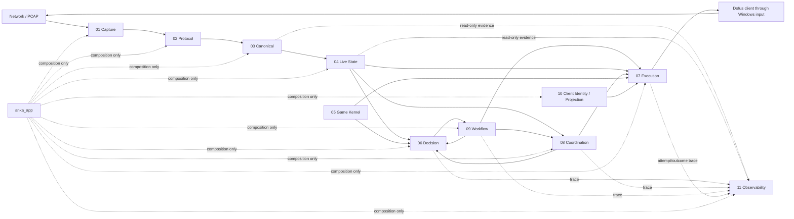

# ANKA_NEXT — Definitive Master Specification & Implementation Blueprint

**Specification status:** TARGET DESIGN / IMPLEMENTATION CONTRACT — **not a claim of implemented or live-certified behavior**  
**Issued:** 22 October 2026  
**Reference project:** `ANKA_R5_198_PROTOCOL_OPAQUE_DRIFT_FIGHT_CONTINUATION_HARDENED_LEAN_OFFLINE_VERIFIED_FINAL(3).zip`  
**Primary target:** Windows, local/headless operation, multi-account Dofus automation with CRA leader + ENU follower as the first fully accepted configuration.  
**Operator UX:** only `setup.bat`, `start.bat`, and `config/user.json` are normal user-facing controls.  
**Architecture:** modular monolith: 11 independent runtime systems + `anka_contracts` + one composition package (`anka_app`).  
**No dashboard / no Script Studio in the target product.**

---

## 1. Purpose of this documentation set

This ZIP is the **single definitive design source of truth** for ANKA_NEXT. It consolidates and reconciles the requirements, engineering decisions, failure lessons, protocol-update strategy, source-reuse plan, anti-regression architecture, diagnostics design, testing methodology, and development roadmap established during the investigation of the R5.198 reference project.

It is intentionally separated from implementation status. A future source tree may be incomplete, broken, or mid-migration while this target remains stable. Current implementation claims belong in `IMPLEMENTATION_STATUS.md`, using the template included in this ZIP.

A new ChatGPT conversation or developer should be able to start here and answer:

- What are we building and why?
- What are the independent systems and who owns each state/decision?
- What is allowed to depend on what?
- What must remain stable when the network protocol changes?
- How do CRA and ENU share a fight without cross-account race conditions?
- What makes a state field trusted, stale, unknown, or insufficient?
- How is a physical click separated from a proven game outcome?
- How does the project prevent the old live-test → bug → patch → next-bug cycle?
- What must be logged automatically from `setup.bat` onward?
- What tests and evidence are required before a live run?
- What does “finished” actually mean?

---

## 2. Read this documentation in this order

1. **[Product Requirements & Engineering Principles](docs/01_PRODUCT_REQUIREMENTS.md)**  
   The mission, scope, hard constraints, quality goals, operator experience, and non-goals.
2. **[Architecture & Dependency Boundaries](docs/02_ARCHITECTURE_AND_BOUNDARIES.md)**  
   The top-level topology, authority model, legal imports, composition model, and diagrams.
3. **[System Specifications](docs/03_SYSTEM_SPECIFICATIONS.md)**  
   Concise system-by-system overview. Detailed individual system pages live under `docs/systems/`.
4. **[Contracts, State, Identity & Runtime Flow](docs/04_CONTRACTS_STATE_AND_RUNTIME.md)**  
   Shared contracts, epochs, evidence semantics, action lifecycle, commit model, state freshness, and sequence diagrams.
5. **[Protocol Evolution & Biweekly Upgrade Process](docs/05_PROTOCOL_EVOLUTION.md)**  
   How new Dofus wire versions are isolated, reverse-engineered, certified, promoted, and rolled back.
6. **[Reliability, Recovery & Concurrency](docs/06_RELIABILITY_RECOVERY_CONCURRENCY.md)**  
   Failure containment, crash semantics, state consistency, retry rules, race prevention, and recovery.
7. **[Diagnostics, Observability & GPT-Friendly Forensics](docs/07_DIAGNOSTICS_AND_FORENSICS.md)**  
   Automatic tracing from setup/start through gameplay, incident bundles, privacy, and first-divergence diagnosis.
8. **[Configuration, Operations & Packaging](docs/08_CONFIGURATION_OPERATIONS_PACKAGING.md)**  
   JSON-only operator configuration, `setup.bat`/`start.bat`, automatic account/window/class detection, packaging, and startup.
9. **[Testing, Verification & Quality Gates](docs/09_TESTING_VERIFICATION_QUALITY_GATES.md)**  
   Unit, contract, replay, state-machine, fault-injection, integration, packaging, Windows, and live acceptance rules.
10. **[Development Roadmap](docs/10_DEVELOPMENT_ROADMAP.md)**  
    Dependency-aware build order from foundation to live acceptance, with completion criteria per milestone.
11. **[Reuse & Migration from R5.198](docs/11_REUSE_AND_MIGRATION.md)**  
    What to preserve, adapt, reimplement, or discard from the existing project.
12. **[Traceability, ADRs, Risks & Open Questions](docs/12_TRACEABILITY_ADRS_RISKS.md)**  
    Requirement IDs, decisions, historical root causes, unresolved evidence, and decision-reversal criteria.
13. **[Definition of Done](docs/13_DEFINITION_OF_DONE.md)**  
    The evidence required to call a system, release, protocol adapter, and the whole project complete.
14. **Appendices**  
    - [Historical failure patterns](appendices/A_HISTORICAL_FAILURES.md)
    - [Glossary](appendices/B_GLOSSARY.md)
    - [Illustrative schemas](appendices/C_EXAMPLE_SCHEMAS.md)
    - [Reference evidence/provenance](appendices/D_REFERENCE_EVIDENCE.md)
    - [Minimum scenario test catalog](appendices/E_SCENARIO_TEST_CATALOG.md)
    - [Engineering references](appendices/F_ENGINEERING_REFERENCES.md)
    - [Implementation-status template](templates/IMPLEMENTATION_STATUS_TEMPLATE.md)

---

## 3. Final target architecture

```text
ANKA_NEXT/
├── src/
│   ├── anka_contracts/        # Shared immutable DTOs, IDs, versions, error vocabulary and ports
│   ├── anka_capture/          # 01 Raw network acquisition, flow attribution, TCP continuity
│   ├── anka_protocol/         # 02 Versioned wire framing/decoding -> candidate canonical events
│   ├── anka_canonical/        # 03 Semantic admission, ordering, atomic durable journal/cursor
│   ├── anka_live_state/       # 04 Pure deterministic reducers, immutable world/fight snapshots
│   ├── anka_game_kernel/      # 05 Existing deterministic game rules/mechanics/data — preserve
│   ├── anka_decision/         # 06 CRA/ENU/world/placement planning; no physical input
│   ├── anka_execution/        # 07 Sole physical input authority + action outcome settlement
│   ├── anka_coordination/     # 08 Multi-account roster, same-fight coherence, Ready/turn barriers
│   ├── anka_workflow/         # 09 Mission/campaign lifecycle, budgets, recovery and progress
│   ├── anka_client/           # 10 Windows process/window identity, calibration, UI projection
│   ├── anka_observability/    # 11 Passive diagnostics, incidents, evidence correlation, exports
│   └── anka_app/              # Composition root, strict config, CLI, bootstrap, startup/shutdown
├── config/
│   ├── user.json              # Only normally user-edited configuration
│   └── schema/
├── assets/
│   ├── game_data/
│   ├── class_profiles/
│   ├── calibration/
│   └── protocol/
├── native/
│   └── unity_bridge/
├── tests/
│   ├── unit/
│   ├── contracts/
│   ├── integration/
│   ├── replay/
│   ├── lab/
│   └── windows_acceptance/
├── tools/                     # Developer Python tools; NOT extra user-facing BAT launchers
├── runtime/                   # Generated runs, durable journals and diagnostics
├── setup.bat                  # User-facing release setup/install only
├── start.bat                  # User-facing run launcher only
└── pyproject.toml
```

The 11 packages are **logical and physical source boundaries**, not 11 Windows applications. The initial deployment is one local Python process (plus the required native Unity bridge if enabled). A separate process/service is added only if measured reliability or performance justifies it.

---

## 4. Runtime data flow



Runtime arrows do **not** imply concrete Python imports. Cross-system collaboration uses interfaces and immutable DTOs from `anka_contracts`, injected by `anka_app`.

---

## 5. The core engineering invariants

These are non-negotiable unless a future ADR provides stronger evidence and replaces the relevant tests.

1. **One owner per mutable authority.** There is one Canonical writer, one run/workflow owner, one party/turn authority, and one physical input authority.
2. **No raw wire detail leaks downstream.** Protocol-specific names, opcodes, obfuscated fields, framing, and decoder state stop inside `anka_protocol`.
3. **Unknown is never converted to a convenient value.** `UNKNOWN` is not `0`, `False`, “no cooldown,” “same cell,” or “success.”
4. **A click is not an outcome.** `SENT` / `MAY_HAVE_SENT` / `CONFIRMED` / `SETTLED` are distinct states.
5. **Ambiguous external side effects are not blindly retried.** If the OS input may have been delivered, hold and reconcile authoritative state.
6. **Current live state is immutable per revision.** Planning uses a frozen frame; Execution re-reads the latest authoritative state immediately before input.
7. **Kernel rules are deterministic and reusable.** Kernel does not parse packets, focus windows, own live state, or click.
8. **Cross-account coherence is explicit.** CRA and ENU do not share a fake global revision; Coordination validates a vector of per-account cursors and one fight epoch.
9. **Protocol updates are isolated.** A wire-only Dofus build change should normally modify only a versioned adapter, its evidence/manifests, and release selection metadata.
10. **Safety gates are tested in both directions.** Tests must prove a rule blocks unsafe input *and* does not falsely block a valid state.
11. **Diagnostics are passive.** Observability never decides to cast, move, retry, or grant control authority.
12. **Diagnostics start before Python dependencies.** Setup/start failures must still leave useful evidence.
13. **Every confirmed incident becomes regression evidence.** The same causal failure family should not require rediscovery from a new live run.
14. **No dashboard in the target product.** Terminal/JSON + automatic incident export are sufficient unless measured needs justify a future ADR.
15. **Only `setup.bat` and `start.bat` are normal operator batch files.** Developer verification remains Python/internal tooling.
16. **Do not confuse architecture cleanliness with correctness.** A moved folder is not complete until contracts, parity, fault tests, diagnostics and relevant integration evidence pass.
17. **Offline verification and live acceptance are separate states.** Neither may be inferred from the other.

---

## 6. Operator experience

The normal user workflow is deliberately small:

```text
1. Extract release ZIP
2. Run setup.bat
3. Edit config/user.json if names/mission settings changed
4. Run start.bat
5. Read terminal status
6. If blocked/failure: provide automatically generated incident ZIP to GPT/developer
```

`config/user.json` contains operator choices only: player names/roles, route/mode, monster bounds, target wins/attempt limits, and selected safe policies. Internal protocol manifests, calibration, game-data versions, class profiles and diagnostics defaults are shipped assets.

Automatic account discovery must verify the intended character, live class/breed, PID/process generation, HWND/window, gameplay flow, bridge/calibration generation and required spell/loadout evidence. **Player name is a lookup hint, not authorization.**

---

## 7. Protocol-update promise

The external protocol may change roughly every two weeks. The target operating model is:

```text
new client/build evidence
 -> staged adapter
 -> structural checks
 -> semantic replay/oracle comparison
 -> consumer contract + reducer/state replay
 -> fault/mutation tests
 -> observe-only current-build acceptance
 -> action-scoped current-build acceptance
 -> disarmed safe-session activation
```

When wire representation changes but game semantics remain the same, **Kernel, Decision, Execution, Coordination and Workflow source should remain unchanged**. If a genuinely new gameplay rule or required semantic concept appears, the system must declare that explicitly and change the appropriate stable contract/rule owner rather than hiding the change inside the decoder.

---

## 8. Diagnostics promise

Every significant run has a causal evidence chain from setup/start through gameplay. On failure, ANKA creates a bounded, sanitized incident bundle that explains:

- what was attempted;
- which system made the decision;
- exact run/account/fight/turn/action identities;
- last known authoritative state/cursor;
- first observed divergence from expected behavior;
- whether physical input was never sent, sent, maybe sent, confirmed, or settled;
- protocol build/adapter/rulepack/config hashes;
- evidence that supports each diagnostic finding;
- evidence that contradicts it;
- missing or stale evidence;
- recovery attempts and outcome;
- one targeted next verification step.

If root cause cannot be distinguished, the report says `UNDETERMINED` or `MULTIPLE_PLAUSIBLE` instead of inventing certainty.

---

## 9. Verification status vocabulary

Use these status categories instead of subjective percentages:

- `NOT_IMPLEMENTED`
- `IMPLEMENTED_UNVERIFIED`
- `UNIT_VERIFIED`
- `CONTRACT_VERIFIED`
- `REPLAY_VERIFIED`
- `FAULT_VERIFIED`
- `ZERO_INPUT_INTEGRATED`
- `WINDOWS_STARTUP_VERIFIED`
- `OBSERVE_ONLY_ACCEPTED`
- `ACTION_SCOPE_ACCEPTED`
- `LIVE_MISSION_ACCEPTED`
- `BLOCKED_MISSING_EVIDENCE`
- `BLOCKED_INCOMPATIBLE_BUILD`
- `FAILED`

A release can legitimately be `OFFLINE_VERIFIED` while live mission acceptance is still pending.

---

## 10. What constitutes a finished ANKA_NEXT

A “final” project is not one that merely starts or wins one fight. It must demonstrate, on the exact packaged release:

- enforced package boundaries with no forbidden concrete cross-imports;
- reproducible clean Windows setup;
- strict JSON configuration and automatic identity/class/window attestation;
- exact current-client protocol/build qualification for all enabled actions;
- deterministic kernel correctness for required game rules/data;
- durable canonical/state replay consistency under crash/fault injection;
- correct CRA and ENU decision behavior through stable contracts;
- multi-account join/Ready/placement/turn/fight/re-entry synchronization;
- one physical input authority and no duplicate send after ambiguity/crash;
- diagnostic evidence complete enough to explain deliberately injected failures;
- zero-input end-to-end systemic scenarios;
- bounded Windows/client live acceptance proving first action, resource settlement, CRA→ENU handoff, ENU action, fight end and world re-entry;
- historical regression corpus passing without weakening fail-closed behavior;
- exact source/config/assets/test hashes attached to verification receipts;
- known limitations and unsupported capabilities explicitly recorded.

See **[Definition of Done](docs/13_DEFINITION_OF_DONE.md)** for the complete acceptance contract.

---

## 11. Key unresolved evidence at specification time

This specification intentionally preserves unknowns rather than hiding them:

- the exact current Dofus build and its complete protocol semantics on the user's next live run;
- current Windows/DPI/focus validity of historical 1280×649 coordinates;
- current runtime proof of automatic breed/loadout/spell-slot identification;
- full current-client Ready → first turn → CRA → ENU handoff → world re-entry evidence;
- behavior under more than two accounts and real eight-account load;
- complete current map-data coverage beyond the shipped/required route subset;
- mechanics previously left unsupported/indeterminate (for example exact tackle/lock cases) unless implemented and certified later.

These are not reasons to delay foundational development. They are explicit later acceptance gates.

---

## 12. Documentation governance

- This ZIP describes the **target**.
- Use `templates/IMPLEMENTATION_STATUS_TEMPLATE.md` for the current state.
- Every target-design change gets an ADR entry in `docs/12_TRACEABILITY_ADRS_RISKS.md` or a new versioned ADR file.
- Every protocol build gets an immutable adapter certification manifest.
- Every significant failure gets an incident ID and—when confirmed—a regression case ID.
- Never rewrite history to make an earlier release appear verified under evidence it never had.

