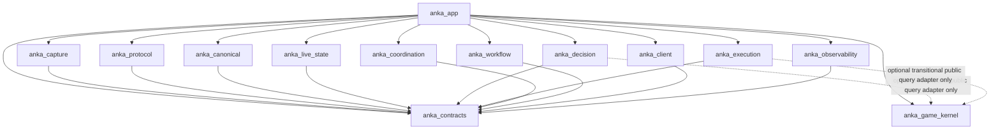

# 02 — Architecture & Dependency Boundaries

## 1. Architecture style

ANKA_NEXT is a **modular monolith**: physically separate Python packages in one source tree and initially one local runtime process, composed explicitly by `anka_app`. This maximizes local reliability and observability while avoiding needless distributed-system failure modes.

Physical separation is necessary but not sufficient. Each system must have:

- one coherent responsibility;
- explicit owned state/authority;
- stable public API/ports;
- immutable inter-system contracts;
- independent tests/fakes;
- no imports of another system's private modules;
- typed errors/health;
- diagnostic events;
- a clear migration/cutover owner.

---

## 2. Top-level packages

| Package | Role | Mutable authority |
|---|---|---|
| `anka_contracts` | Shared DTOs, IDs, versions, ports, error vocabulary | none; definitions only |
| `anka_capture` | Network acquisition, flow binding, TCP continuity/gaps | capture session/stream continuity |
| `anka_protocol` | Wire framing/decoding/version adapter/certification | decoder context per stream/build |
| `anka_canonical` | Semantic admission/order/durable event journal | canonical sequence/cursor and physical DB commit |
| `anka_live_state` | Deterministic reducers and immutable snapshots | state semantics; published snapshot revision |
| `anka_game_kernel` | Deterministic rules/mechanics/static knowledge | versioned rules/data; no live state |
| `anka_decision` | World/fight/placement planning and policy | planner/policy config and action selection |
| `anka_execution` | Final action admission, input arbitration, attempt/outcome settlement | physical action/input ledger and lease |
| `anka_coordination` | Multi-account roster, fight coherence, barriers, turn permits | party/fight/turn coordination state |
| `anka_workflow` | Mission/run lifecycle, budgets, recovery, progress | run/workflow state and counters |
| `anka_client` | Windows process/window identity, calibration, projection | client binding/calibration/projection generation |
| `anka_observability` | Passive diagnostics, incident correlation/export | diagnostic evidence only; no gameplay authority |
| `anka_app` | Composition root, config, bootstrap, lifecycle wiring | process/run composition and startup/shutdown ownership |

`anka_app` is not counted as a gameplay system.

---

## 3. Compile-time dependency rule

The **target** import graph is deliberately stricter than runtime collaboration.



Preferred final state: Decision/Execution receive `KernelQueries` through an injected port; Kernel stays independently reusable and need not import `anka_contracts`.

### 3.1 Forbidden implementation imports

Examples of forbidden edges:

```text
anka_capture      -> anka_protocol concrete implementation
anka_protocol     -> anka_capture concrete implementation
anka_protocol     -> anka_live_state / anka_decision / anka_execution
anka_canonical    -> anka_protocol adapter internals
anka_canonical    -> anka_live_state concrete implementation
anka_live_state   -> anka_protocol
anka_decision     -> anka_execution / anka_workflow / concrete coordination
anka_execution    -> tactical AI / protocol adapter internals / workflow concrete implementation
anka_coordination -> anka_workflow concrete implementation
anka_workflow     -> coordination/execution/decision concrete implementation
anka_observability-> gameplay private implementations
anka_client       -> decision/workflow/execution private implementation
any domain system -> anka_app
```

Runtime collaboration occurs through ports from `anka_contracts` and composition wiring.

### 3.2 No dependency-check bypasses

Architecture tests must also search for:

- imports inside functions;
- `TYPE_CHECKING` imports;
- `importlib` dynamic imports;
- service locator/global registry tricks;
- `getattr`/string-import bypasses used to evade package boundaries.

Dynamic adapter discovery is allowed only behind an explicit, reviewed protocol registry contract.

---

## 4. Authority model

Architecture is primarily about **who may assert truth or cause effects**.

| Authority | Owner | Other systems may… | Other systems may NOT… |
|---|---|---|---|
| Wire continuity | Capture | consume envelopes/gaps | reinterpret missing bytes as complete |
| Wire semantic meaning | Protocol | consume candidate semantic events | embed raw protocol meaning into AI/Kernel |
| Committed semantic history | Canonical | read by cursor | insert/rewind journal independently |
| Current world/fight state | Live State | query immutable snapshots | write actor HP/AP/MP directly |
| Static game mechanics | Kernel | query deterministic results | modify rules based on live packet quirks |
| Proposed actions | Decision | plan/score/abstain | click or declare game result |
| Physical input/action settlement | Execution | receive semantic commands | be bypassed by Workflow/AI/watchdog |
| Party/turn permit | Coordination | Workflow/Execution query permit | Workflow invent owner from one client |
| Mission/run phase | Workflow | other systems report outcomes | Coordination/Execution increment wins |
| Client/window/projection | Client | Execution query proof | treat HWND/title as game state |
| Diagnostic interpretation | Observability | inspect/export evidence | grant control or mutate state |
| Wiring/process lifecycle | App | construct/inject/start/stop | implement hidden game strategy |

---

## 5. Canonical + Live State boundary

This boundary is intentionally nuanced.

### 5.1 Separate ownership

- **Canonical** owns admitted semantic events, durable order, source event identity, deduplication and the database commit.
- **Live State** owns reducer semantics, field provenance/freshness, immutable snapshots and read APIs.

### 5.2 Preserve one commit unit

R5.198 already has a strong invariant: event journal rows, relevant checkpoint/evidence and visible state advancement are coordinated transactionally. ANKA_NEXT MUST preserve equivalent safety during migration.

Recommended architecture:

```text
Protocol CandidateCanonicalBatch
  -> Canonical validates schema/identity/order
  -> Canonical calls injected StateProjectorPort.prepare(previous_snapshot, batch)
  -> Live State pure projector returns next-state/checkpoint candidate (no I/O authority)
  -> Canonical opens ONE SQLite transaction
       append committed event rows
       append/version checkpoint / terminal evidence
       update required metadata
     COMMIT
  -> Canonical publishes CommittedBatch(cursor)
  -> Live State publishes immutable snapshot at committed cursor
```

`anka_canonical` imports only the projector **port**, not `anka_live_state` concrete code. `anka_app` injects the implementation.

If a future journal-first/asynchronous projection design is desired, it requires a new ADR and crash/replay evidence proving state cannot get ahead of/behind authoritative journal in a way that permits unsafe actions.

---

## 6. Execution + Outcomes boundary

Outcome verification stays inside `anka_execution` initially because physical send, uncertainty and settlement form one safety-critical transaction lifecycle.

Internal subpackages SHOULD separate:

- action command/admission;
- control authority;
- input arbiter;
- physical driver;
- durable attempt ledger;
- outcome requirements/correlation;
- settlement/reconciliation;
- pointer motion.

They remain one top-level authority. Extracting a new standalone Outcomes system is justified only after evidence demonstrates a distinct lifecycle/scaling need and crash tests prove the split does not create duplicate/ordering risk.

---

## 7. Runtime communication

Use a hybrid model.

### 7.1 Synchronous typed query/command ports

Use direct injected calls for:

- current state snapshots;
- Kernel legality queries;
- client projection proof;
- party turn permit;
- decision planning request;
- execution submit/admission;
- config/health query.

These are explicit, fast and easy to fake.

### 7.2 Asynchronous bounded event notifications

Use bounded event/notification paths for:

- captured wire envelopes;
- committed canonical batches;
- state revision publication;
- diagnostic traces;
- selected workflow/outcome notifications.

**The durable journal is the source of truth.** Notifications are wakeups. Subscribers resume from a cursor and deduplicate; no exactly-once delivery claim.

### 7.3 Backpressure

- Gameplay-critical capture/event queues are bounded.
- If continuity is lost, emit a gap and fence affected semantic trust.
- Never silently drop gameplay data to keep UI/diagnostics responsive.
- Diagnostic low-priority events may be sampled/dropped under pressure, with explicit loss counters.

---

## 8. Threading/concurrency model

Initial recommended model:

```text
Capture backend worker(s)
 -> per-flow TCP/stream ordering
 -> decoder workers partitioned by flow/adapter context
 -> canonical single-writer admission lane
 -> live-state immutable revision publication

Workflow/run loop
 -> coordination query
 -> decision request
 -> execution command
 -> outcome reconciliation

One host-wide physical input arbiter
 -> per-client/account lanes
 -> exactly one active physical send lease

Observability worker
 -> bounded queue
 -> local run records / incident export
```

No shared mutable dict is considered a synchronization strategy. Each stateful owner must define locks/serialization, generation IDs and shutdown semantics.

---

## 9. Generation and epoch model

Old evidence must not affect a new incarnation. At minimum distinguish:

- `release_id` / source hash;
- `invocation_id` (one BAT/program invocation);
- `run_id` / run generation;
- `client_instance_id` (process generation, not PID alone);
- `window_generation`;
- `connection_id` / flow generation;
- `world_epoch`;
- `fight_epoch`;
- `turn_epoch`;
- `canonical_cursor` / snapshot revision;
- `input_lease_epoch`;
- `action_id` + `attempt_id`;
- `adapter_release_id`;
- `calibration_generation`.

Epoch changes invalidate relevant cached permits/projections/plans.

---

## 10. Cross-account consistency

There is no assumption that CRA and ENU network streams share one perfectly synchronized clock or global canonical revision.

Coordination validates a **vector**:

```text
PartyCoherenceFrame:
  run_id
  party_id
  fight_epoch
  expected_members
  per_member:
    client_generation
    canonical_cursor
    fight_identity
    actor_identity
    phase
    ready_status
    turn_owner_view
    freshness/health
  coherent_turn_owner
  barrier
  permit_generation
```

A party action is permitted only when required evidence is mutually compatible. Wall-clock closeness alone is insufficient.

---

## 11. Composition root

`anka_app` is the only package that creates real concrete system implementations and wires them together.

Responsibilities:

- load/validate release + user config;
- create diagnostics bootstrap context;
- initialize assets/manifests;
- build Capture/Protocol/Canonical/LiveState/Kernel/Decision/Execution/Coordination/Workflow/Client/Observability;
- inject typed ports;
- run startup/readiness checks;
- supervise worker health/shutdown;
- reconcile prior unclean run before arming input.

It MUST NOT contain tactical spell selection, wire decoding, actor state mutation, mouse path logic or hidden party policy.

---

## 12. Deployment independence

Separate folders do **not** require separate processes. Process separation is a future optimization/failure-isolation decision only if profiling proves it beneficial.

Potential future candidates:

- raw capture helper requiring privileges;
- Unity bridge/native component;
- heavy offline replay/forensic analysis.

Physical input authority should remain local and simple. Do not distribute it across network services.

---

## 13. Architecture verification

Every release MUST produce a dependency receipt including:

- top-level import graph;
- forbidden edge count (must be zero for target rules);
- strongly connected components among top-level domain packages (must be none, excluding allowed contracts/composition direction);
- dynamically registered adapters;
- public API list;
- concrete state writers;
- input driver instances;
- composition-root bindings.

A system is not independent because its directory exists; independence is demonstrated by replacing it with a fake at its ports without editing neighboring systems.

