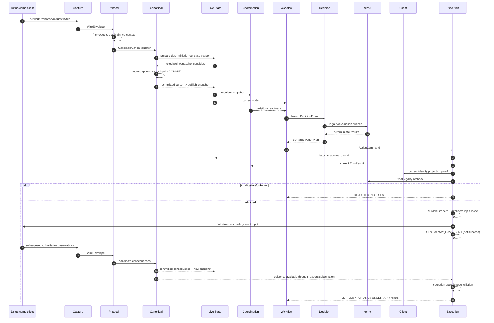

# 04 — Contracts, State, Identity & Runtime Flow

## 1. Why contracts are the architecture

Separate directories only become independent systems when their **shared meanings** are explicit and stable. `anka_contracts` is deliberately small and contains the vocabulary required at boundaries.

It must NOT become a generic dumping ground. Private tactical scores, SQLite row models, raw packet classes, mouse-driver options and dashboard/read-model concepts do not belong there.

---

## 2. Contract families

```text
anka_contracts/
  ids.py
  versions.py
  evidence.py
  wire.py
  canonical.py
  state.py
  mechanics.py
  decision.py
  action.py
  coordination.py
  workflow.py
  client.py
  diagnostics.py
  errors.py
  ports/
    wire_sink.py
    canonical_admission.py
    committed_event_reader.py
    state_reader.py
    state_projector.py
    kernel_queries.py
    decision_planner.py
    action_executor.py
    party_coordinator.py
    client_projection.py
    diagnostics_sink.py
    control_commands.py
```

Every public contract has an owner, version, compatibility policy and tests.

---

## 3. Identity contract

### 3.1 Stable IDs

Use opaque IDs/typed wrappers, not user-visible strings as identity keys.

Recommended identities:

- `InvocationId` — one setup/start process invocation;
- `RunId` — one mission run generation;
- `PartyId`;
- `AccountId` / configured role identity;
- `ClientInstanceId` — process generation, not PID alone;
- `WindowGeneration`;
- `ConnectionId` / FlowId;
- `WorldEpoch`;
- `FightEpoch`;
- `TurnEpoch`;
- `CanonicalCursor`;
- `SnapshotId`;
- `PlanId` / `ActionKey`;
- `ActionId`;
- `AttemptId`;
- `InputLeaseEpoch`;
- `AdapterReleaseId`;
- `CalibrationGeneration`;
- `IncidentId`.

### 3.2 No stale identity reuse

PID reuse, HWND reuse, actor-ID reuse across fights, or restarted flows cannot inherit permits from an earlier generation.

---

## 4. Evidence semantics

Use a standard evidence classification:

```text
AUTHORITY_COMMITTED    # canonical durable truth
OBSERVED_EXTERNAL      # packet/OS/bridge observation not yet authoritative for all semantics
DERIVED                # deterministic derivation from cited authoritative evidence
HEURISTIC              # useful but cannot authorize safety-critical input alone
UNKNOWN
STALE
CONFLICTING
MISSING
```

An evidence item includes source references and scope. A field may be observed but not authoritative for the requested actor/fight/action.

### 4.1 Negative evidence

The absence of an observed packet/action is only meaningful when capture completeness, selected flow, time/sequence window and current-build semantics certify that such an event **would have been visible**. Do not infer negative truth from silence casually.

---

## 5. Wire contract

`WireEnvelope` contains transport facts only:

```text
capture_session_id
client_instance_id
connection_id
flow direction
stream offset/range
producer sequence
wall + monotonic observation time
payload bytes/reference
continuity/gap flag
```

It contains no AP/MP/spell semantics.

---

## 6. Canonical event contract

A `CanonicalEventEnvelope` contains:

```text
event_id
canonical_schema_major/minor
semantic_kind
client/account identity
world/fight/turn scope as applicable
source adapter/build
source wire refs
field/value payloads
provenance/trust
event-time if proven + observed-time
```

Event meanings are stable across wire adapters. A renamed/obfuscated raw message does not rename a Canonical semantic event.

Candidate events become committed only after Canonical validation/transaction.

---

## 7. State contracts

### 7.1 Snapshot identity

A state snapshot includes:

```text
run_id
account/client_generation
world_epoch
fight_epoch
turn_epoch
canonical_cursor
snapshot_revision/hash
adapter/build identity
state reducer revision
rulepack/data revision reference
health/completeness
field proofs
```

### 7.2 Critical field proofs

At minimum support proof status for:

- map/world identity;
- actor identity/team;
- actor cell;
- HP/current/max as applicable;
- AP/MP;
- turn owner/round;
- fight phase;
- spell/loadout/cooldown/per-target/per-turn facts needed by policies;
- fight end/reentry.

`UNKNOWN` is represented explicitly.

---

## 8. Mechanics contracts

`KernelQueries` is a pure query surface. Typical operations:

```text
validate_cast(context, spell, target)
reachable_cells(context, movement_budget)
validate_move(context, path/target)
line_of_sight(context, source, target)
spell_readiness(context, spell)
evaluate_effect_geometry(...)
```

Results include `LEGAL`, `ILLEGAL(reason)`, or `INDETERMINATE(reason)` where rules/data are unsupported.

A Kernel result is not an execution permit because live state may change after the query.

---

## 9. Decision contracts

`DecisionFrame` freezes relevant snapshot and workflow goal. `PlannerResult` must be explicit:

```text
PLAN(ActionPlan)
WAIT(required_evidence, reason)
NO_ACTION(reason)
FAULT(code, context)
```

`ActionPlan` includes semantic target and expected outcome requirements, not pixels.

`ActionKey` is one canonical semantic fingerprint used for quarantine/anti-loop across Decision and Execution.

---

## 10. Action/execution contracts

### 10.1 Command

```text
ActionCommand:
  action_id
  run_id/account/client/fight/turn identity
  action_key
  kind
  semantic target
  plan basis snapshot/cursor
  validity constraints
  expected outcome proofs
  deadline/budget metadata
```

### 10.2 Physical attempt

```text
PhysicalAttempt:
  attempt_id
  action_id
  input lease generation
  window/projection proof
  prepared durable reference
  send state = NOT_SENT | SEND_STARTED | SENT | MAY_HAVE_SENT
  timestamps
```

### 10.3 Outcome

```text
ActionOutcome:
  action_id/attempt_id
  status = REJECTED_NOT_SENT | PENDING | CONFIRMED_UNSETTLED |
           SETTLED_SUCCESS | PROVEN_FAILURE | UNCERTAIN | TERMINAL_UNRESOLVED
  evidence refs
  resource/state obligations
  retry eligibility
```

Local ActionId is not assumed to be echoed by server protocol. Correlation can use direct IDs when available; otherwise it uses operation-specific actor/fight/turn/causal evidence and a single-pending-action invariant where required.

---

## 11. Coordination contract

`PartyCoherenceFrame` carries a **vector** of member state/cursors. It exposes:

- required member set;
- same fight/phase proof;
- placement/join/Ready barrier;
- coherent current owner;
- freshness/health per member;
- permit generation;
- missing/conflicting evidence.

No fabricated global canonical revision.

---

## 12. Workflow contract

Workflow public states and transitions are versioned. Every transition records:

- old/new phase;
- trigger/evidence;
- run/fight generation;
- expected next evidence/deadline;
- recovery budget;
- terminality.

Counters change only on idempotent authoritative transitions.

---

## 13. Client contract

`ClientIdentity`/`ProjectionEvidence` includes:

- process PID + creation generation;
- HWND/window generation;
- configured character/account match proof;
- live class/breed proof;
- bridge generation/source;
- window size/DPI/viewport;
- map/calibration generation;
- semantic target -> pixel result;
- freshness and invalidators.

No Client DTO asserts Kernel legality.

---

## 14. Diagnostic contract

Events use stable low-cardinality names and structured values. Correlation IDs are first-class. Diagnostic records never become permission tokens.

See [Diagnostics](07_DIAGNOSTICS_AND_FORENSICS.md).

---

## 15. Runtime sequence: packet to settled cast



---

## 16. Protocol/Canonical transaction ordering

If decoder context changes while transforming a batch:

1. Protocol checkpoints its context.
2. It creates candidate events + candidate new context.
3. Canonical validates/commits semantic batch.
4. If commit succeeds, adapter context may advance to the corresponding committed cursor.
5. If commit fails/uncertain, restore or reconstruct adapter context; never continue using speculative decoder state as trusted.

This rule prevents decoding context from getting ahead of durable semantic truth.

---

## 17. Versioning policy

Track independent versions:

```text
protocol_adapter_release
observed_client_build
canonical_schema
state_reducer_revision
kernel_ruleset
game_data_revision
calibration_generation
config_schema
incident_schema
```

### Major/minor

- **Major:** incompatible semantic meaning/required field/contract; requires explicit consumer migration.
- **Minor:** backward-compatible optional/additive change with safe defaults/unknown behavior.

Ignoring unknown JSON fields at active safety boundaries is not a compatibility strategy. Stored legacy migrations may use explicit compatibility readers.

---

## 18. Error contract

Errors use stable codes and structured context. Do not rely on parsing free-form text.

Every error specifies:

- owner system;
- failure boundary;
- severity/control impact;
- scope (run/account/fight/action/capability);
- whether physical input may have occurred;
- retry eligibility;
- evidence refs;
- human message.

A wrapper timeout MUST retain/chain the first meaningful failure code rather than hiding it.

