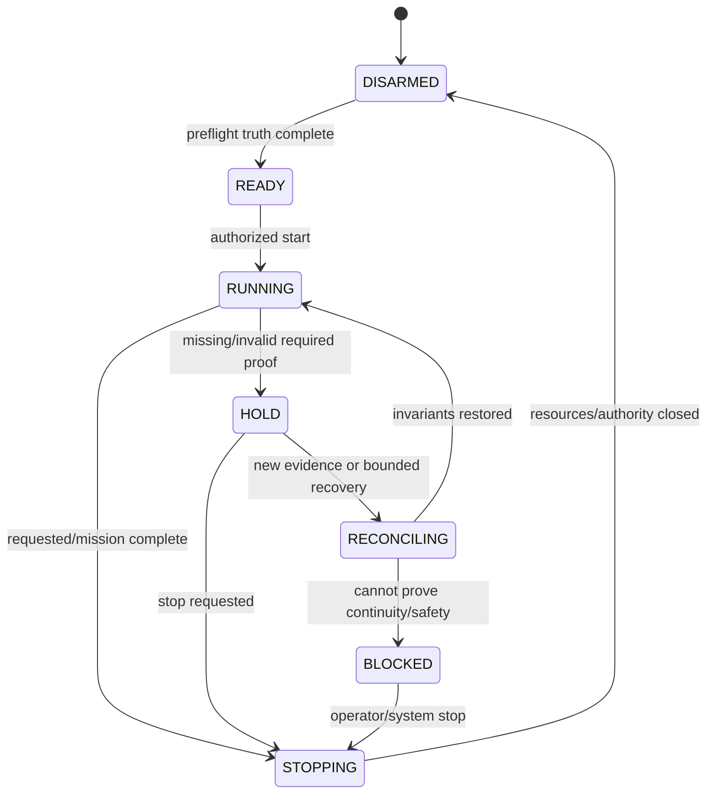

# 06 — Reliability, Recovery & Concurrency

## 1. Reliability philosophy

ANKA_NEXT must fail **precisely**, not merely fail closed globally. Safety and liveness are both requirements: a guard that admits unsafe input is defective, and a guard that permanently blocks valid evidence is also defective.

Historical releases showed both categories:

- malformed action/quarantine loops;
- recoverable delayed confirmation escalated into global disarm;
- stale static geometry overriding live placement;
- incorrect AP/MP freshness floors;
- stale process/control ownership;
- new unknown protocol traffic blocking a fight after a settled cast.

Each is turned into a permanent invariant/test family.

---

## 2. Failure scope model

Every failure has:

```text
owner system
boundary
scope = process | run | account | connection | fight | turn | capability | action
control impact = NONE | HOLD_SCOPE | DISARM_ACCOUNT | DISARM_RUN | STOP
physical_input_state
evidence certainty
recovery disposition
```

Escalate only when a wider invariant depends on the failed scope.

Examples:

- diagnostics exporter failure -> observability degraded, no gameplay authority change;
- ENU turn owner unproven -> ENU/party dependent action held;
- corrupted Canonical durability -> all physical actions depending on state stopped;
- wrong-window identity -> affected account input disarmed;
- exact unrelated proven-opaque packet -> does not automatically block all combat.

---

## 3. Crash consistency

### Canonical

One durable transaction. Ambiguous commit -> fence, reopen/replay durable truth.

### Execution

External Windows input is not transactional with SQLite. Persist intent before possible send, then distinguish:

- definitely not sent;
- send started/may have been delivered;
- driver accepted send;
- authoritative outcome confirmed;
- fully settled.

Crash/restart scans durable action ledger before rearming.

### Workflow

Run state/counters are idempotent by generation/event identity. Fight win is counted once.

### Coordination

Permits are generation-bound; restart invalidates ephemeral permit and reconstructs from current member state.

---

## 4. Retry policy

Retryability is typed, not generic.

| State | Default retry rule |
|---|---|
| local validation rejected, no input possible | replan/new proof allowed |
| proven pre-send driver failure | new attempt may be allowed after revalidation |
| send started/maybe sent | NO duplicate until outcome reconciled |
| confirmed failure from game | policy may choose new action, not automatic replay unless explicitly safe |
| unknown/missing critical evidence | WAIT/reconcile; no optimistic retry |
| protocol unsupported | no gameplay retry; upgrade/evidence workflow |

Use idempotency keys where meaningful, but do not claim external mouse operations are exactly-once.

---

## 5. Watchdogs and liveness

A watchdog observes progress; it does not bypass safety.

Every lifecycle wait defines:

- expected transition;
- start condition;
- monotonic budget;
- progress marker;
- permissible evidence refresh;
- safe recovery;
- terminal reason.

Timeouts do not erase the earlier root failure. Error chaining preserves first divergence.

A watchdog may request a normal End Turn only if Coordination/Execution prove it is currently admissible and no unresolved earlier action conflicts.

---

## 6. Concurrency rules

### 6.1 Stream ordering

Ordering is per connection/flow. Do not fabricate a cross-account total order.

### 6.2 Canonical writer

Serialize durable semantic commits for the relevant journal authority. Readers receive immutable revisions.

### 6.3 State snapshots

No consumer mutates a snapshot. A plan references exact revision/epoch.

### 6.4 Input

One host-wide input arbiter. Account lanes are logical queues; focus-sensitive physical interactions are serialized.

### 6.5 Observer

Observer queue is bounded and non-authoritative. Critical owner ledgers persist independently.

---

## 7. State freshness rules

Freshness is not simply “latest timestamp.” Define per action:

- required field;
- authoritative sources;
- causal lower bound;
- fight/turn scope;
- invalidating events;
- maximum age if time-based aging is actually meaningful.

Test two directions:

1. stale/old evidence must be rejected;
2. valid evidence that arrived earlier than a later lifecycle event but remains semantically current must not be rejected incorrectly.

---

## 8. Race scenarios to test

- turn changes between Decision and Execution;
- target moves after plan;
- focus changes during pointer movement;
- window/process restarts after projection;
- READY/turn event arrives on one account before another;
- duplicate TURN_STARTED;
- old TURN_ENDED arrives late;
- decoder receives reconnect while Canonical batch pending;
- action outcome arrives before input driver returns;
- process crashes after send but before local confirmation persistence;
- observer queue/disk stalls during fight;
- two start attempts race for run/process authority;
- config/release asset changes between setup and start.

---

## 9. Resource and overload behavior

Critical queues and workers publish:

- queue length/capacity;
- oldest item age;
- drop/loss counters;
- worker heartbeat/progress;
- last error;
- current backpressure/fence state.

Capture overflow is a semantic trust failure. Diagnostic queue overflow is a diagnostic completeness failure. They are not equivalent.

---

## 10. Recovery state machine



No transition to RUNNING is allowed simply because a timeout elapsed.

---

## 11. Fault-injection expectations

Every safety-critical system must support injected failures in tests. Required classes include:

- I/O exception;
- storage busy/full/permission;
- delayed callback/event;
- reordered/duplicate/lost input;
- worker crash;
- cancellation/shutdown;
- stale generation;
- wrong actor/client;
- unsupported version;
- ambiguous physical side effect.

The expected result includes forbidden side effects and required diagnostics, not merely an exception type.

