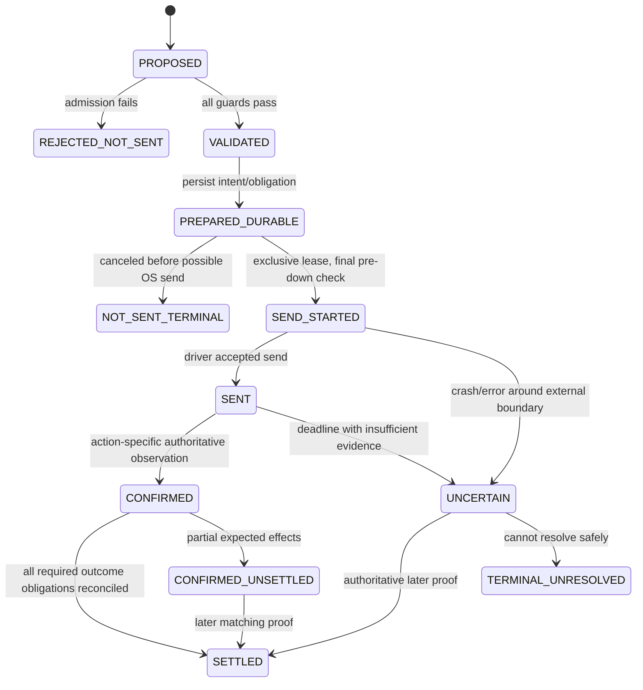

# System 07 — Execution (`anka_execution`)

## Purpose

Execution is the **sole physical-input and action-settlement authority**. It receives a semantic command, revalidates it against the latest truth, performs at most the justified external input, then reconciles authoritative evidence before declaring an outcome.

## Internal packages

```text
anka_execution/
  api.py
  admission/
    latest_state.py
    mechanics.py
    identity.py
    projection.py
    party_permit.py
  authority/
    control_lease.py
    run_generation.py
    disarm.py
  arbitration/
    input_arbiter.py
    account_lanes.py
  drivers/
    windows_input.py
    fake_input.py
  actions/
    cast.py move.py ready.py join.py end_turn.py world.py
  ledger/
    prepared_intent.py
    physical_attempt.py
    uncertainty.py
  outcomes/
    evidence_requirements.py
    correlation.py
    settlement.py
    recovery.py
  pointer/
    path.py
    safe_endpoint.py
  diagnostics.py
```

## Final admission

Immediately before OS input, Execution rechecks:

- run/input authority generation;
- correct account/client/window process generation;
- focus/visibility/geometry requirements;
- current fight/turn/actor identity;
- latest canonical cursor and invalidating changes;
- AP/MP/resources relevant to action;
- Kernel legality against current state;
- party/turn permit;
- calibrated semantic-to-screen projection;
- spell/loadout/slot proof for cast;
- no unresolved conflicting action attempt.

A plan legal at Decision time is not permission to click now.

## Action lifecycle



No DB transaction can make a Windows mouse click exactly once. `SEND_STARTED`/`UNCERTAIN` are therefore first-class states.

## Outcome requirements

Each action kind defines evidence separately. Examples:

- `CAST`: cast semantic observation and required AP/resource/cooldown/target effects according to action type;
- `MOVE`: cell + MP/path outcome evidence;
- `READY`: authoritative ready/phase transition evidence, not click appearance;
- `END_TURN`: authoritative turn-end/new-owner transition;
- world interaction: expected map/scene transition or explicit mismatch.

No universal `ACK == success` assumption.

## Retry rule

- `REJECTED_NOT_SENT`: may replan; semantic ActionKey quarantine rules apply.
- conclusively `NOT_SENT` due to a transient local condition: new attempt may be allowed after new proof.
- `SENT`/`MAY_HAVE_SENT`/`UNCERTAIN`: **no blind duplicate send**. Reconcile authoritative state first.

## Input arbitration

One host-wide physical input arbiter serializes actions that can interfere through focus/mouse/keyboard. Per-account lanes do not imply simultaneous input permission.

## Dependencies

Contracts + injected StateReader, KernelQueries, PartyPermit, ClientProjection/Identity. No Decision implementation import.

## Tests

- stale plan rejected with zero driver calls;
- wrong HWND/focus/DPI/projection;
- illegal move/cast;
- account/turn mismatch;
- crash before prepare, after prepare, during send, after send, after outcome commit;
- action result arrives before driver returns;
- wrong action/actor/fight evidence does not settle;
- delayed confirmation stays scoped/pending where safe;
- one input lease under concurrent accounts;
- no duplicate cast/Ready/EndTurn after restart.

